# Whytide

Whytide finds high-intent B2B leads on LinkedIn from buying signals, qualifies them with AI against your ideal customer profile, shows the evidence behind every lead, and sends outreach only after a person approves it. This repository holds the code of Whytide Core, the source-available, self-hosted edition, and of Whytide Cloud, the hosted service that runs the same code.

**Status:** this is the code at the end of beta, version 0.2.1, published to read. It is not a supported release yet.

## What it does

1. **Company Knowledge.** Paste your website: the AI drafts what you sell, to whom and why, and you edit it.
2. **Ideal customer profile.** Titles, seniorities, industries, company sizes and countries, plus must-haves and disqualifiers in plain text.
3. **Signals.** Point it at LinkedIn posts (yours, a competitor's, a creator's) and it reads the people who reacted or commented, through your own connected LinkedIn account. Or import a CSV of LinkedIn profiles.
4. **Qualification.** Hard filters in code first, then an AI verdict on each criterion with its evidence, then a fit score computed in code and a tier.
5. **Review.** The leads sorted by score, each with the post and what the person did on it. You mark each one Good lead or Not a fit.
6. **Outreach on LinkedIn.** Approving a lead starts one fixed sequence from your own account: a connection request, a first message once it is accepted, then two follow-ups. The AI drafts each message from the facts Whytide holds, and every message waits in "Up next" until you approve, edit or skip it.
7. **Safety.** Daily quotas inside your working hours, under hard maximums that no setting raises. Any reply stops the sequence. A never-contact list, opt-outs, and kill switches per account, per workspace and for the whole platform.
8. **Inbox.** The replies in the threads Whytide started.

## AI agents

### Inside the product

Several AI agents work inside Whytide, each on one job. They run through Mastra inside Temporal activities, see only the facts they are given (qualification gets anonymized profiles), and return structured output that code checks before anything is saved; nothing reaches a prospect until a person approves it.

```mermaid
flowchart LR
  subgraph SETUP["Setup"]
    SITE["your website"] --> KNOW["agent: draft Company Knowledge<br/>you edit it"]
    KNOW --> ICPD["agent: draft the ICP<br/>you edit it"]
  end
  subgraph EACHLEAD["Each lead"]
    FILTERS["hard filters and anonymizer<br/>in code"] --> ASSESS["agent: assess the fit<br/>a verdict per criterion"]
    ASSESS --> SCORE["fit score and tier<br/>in code"]
  end
  subgraph EACHMSG["Each message"]
    DOSSIER["dossier: facts with their sources<br/>in code"] --> PLAN["agent: plan the message"]
    PLAN --> WRITE["agent: write the message"]
    WRITE --> CHECKS["checks in code<br/>grounding, length, placeholders"]
  end
  ICPD --> FILTERS
  SCORE -->|"you approve the lead"| DOSSIER
  CHECKS -->|"Up next: you approve, edit or skip"| SENT["sent on LinkedIn"]
```

### Building it

AI coding agents also build Whytide, in parallel, under the same rules as people ([AGENTS.md](AGENTS.md), [docs/rules/](docs/README.md)): each takes one task in its own git worktree, with its own slice of the development stack, and its work lands only through a reviewed merge request.

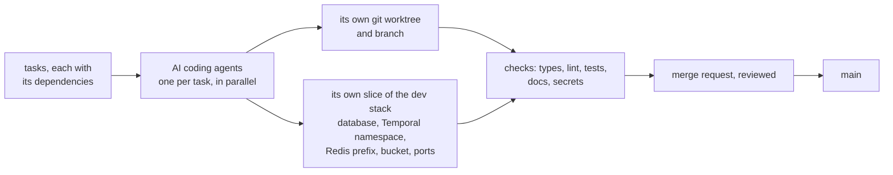

## Architecture

The diagrams come from [docs/architecture.md](docs/architecture.md), the full design; some of what they show arrives in later versions.

**Stack:** TypeScript on Node 26 with pnpm workspaces, Next.js with Tailwind CSS 4, NestJS, Prisma, Temporal, Mastra, PostgreSQL with pgvector, Redis, MinIO, Caddy, OpenTelemetry, Biome and Docker Compose.

### [System context](docs/architecture.md#2-system-context)

Who and what Whytide talks to. LinkedIn goes only through hosted authentication, so Whytide never holds a password or a cookie, and each external system sits behind a port.

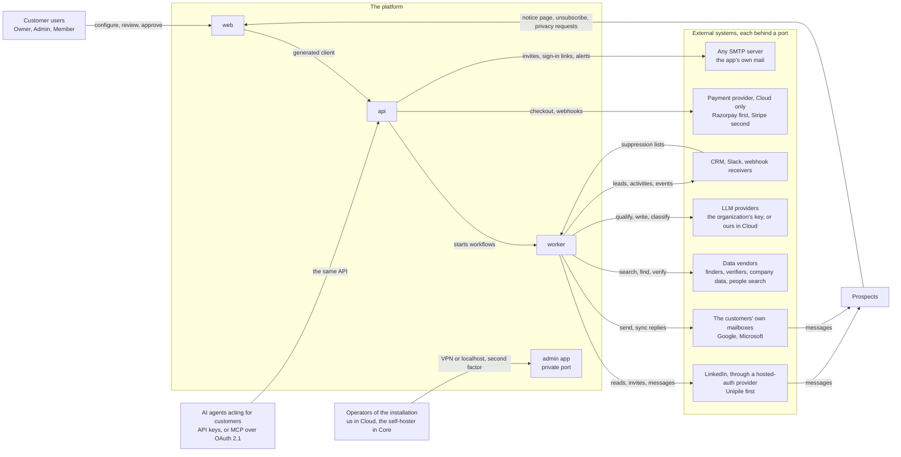

### [Processes](docs/architecture.md#3-processes)

The processes and where state lives. Caddy routes to `web` and `api`, the `worker` runs the background work, and Postgres is the only source of truth; Redis can be wiped.

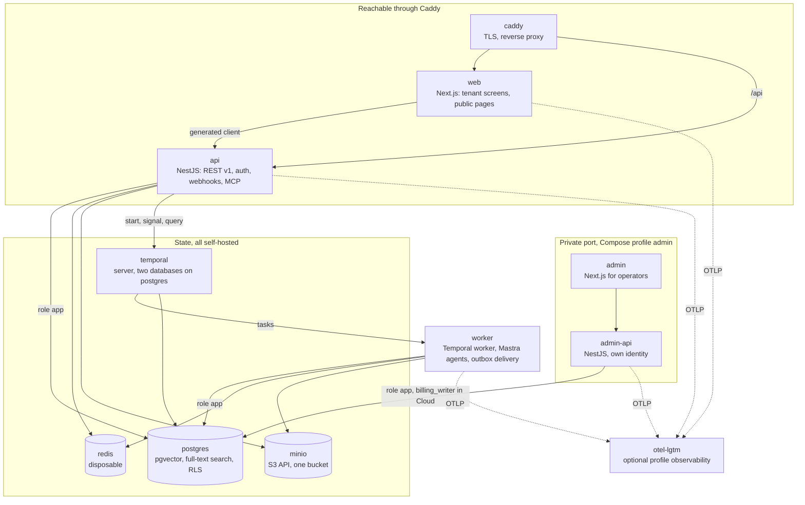

### [How modules talk](docs/architecture.md#43-how-modules-talk)

Modules call each other only through their `index.ts` and talk through events, written to an outbox in the same transaction as the change. A lint rule fails CI on any other import.

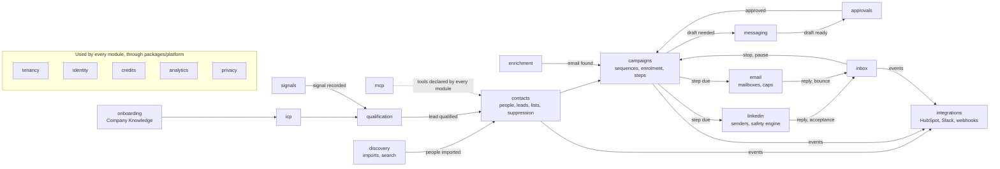

### [A request, end to end](docs/architecture.md#5-a-request-end-to-end)

Every request resolves to a principal (a member, an agent acting for its owner, or a service), and one permission function decides every action. The workspace is set per transaction, so row-level security applies.

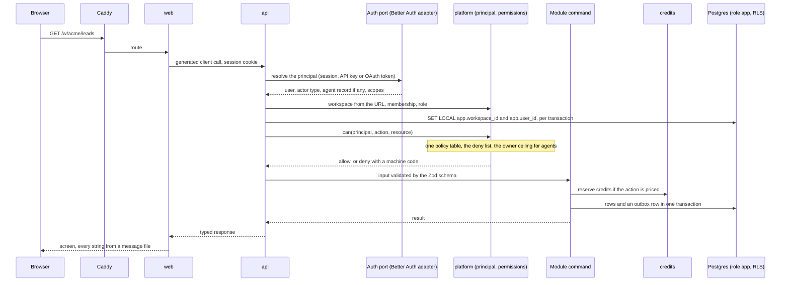

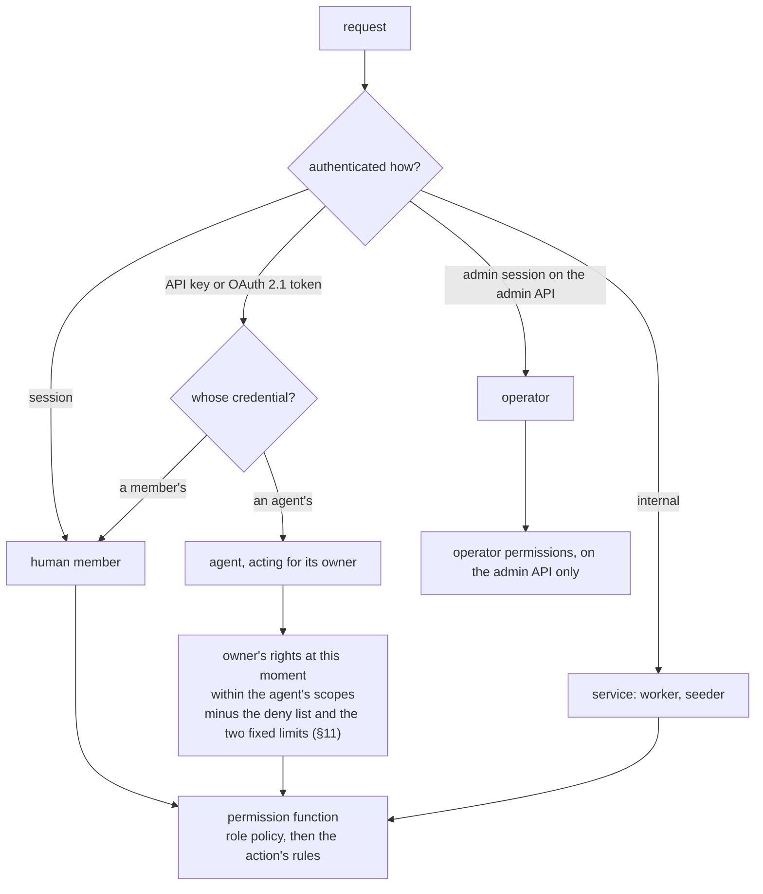

### [Tenancy and isolation](docs/architecture.md#6-tenancy-and-isolation)

Data lives in three scopes: global, organization and workspace. Workspace rows are under row-level security that fails closed: without a workspace, a query returns nothing.

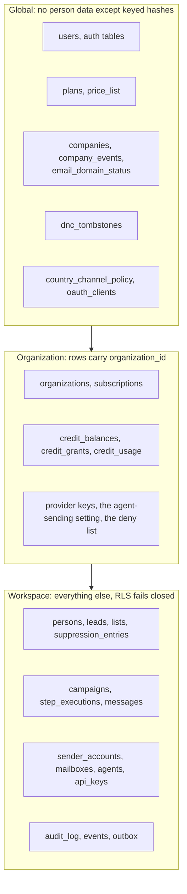

### [Signals, people and leads](docs/architecture.md#73-signals-people-and-leads)

The tables from a signal to a lead: sources and their runs record events about people, and each lead keeps its score snapshots, a verdict per criterion and the reviewer's label.

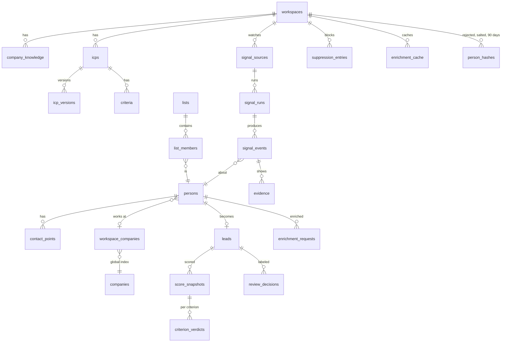

### [Campaigns, senders and inbox](docs/architecture.md#74-campaigns-senders-and-inbox)

The tables of outreach: a campaign enrolls people, each step has its draft and its approval, each sender account keeps its quota, health and action log, and threads hold the messages.

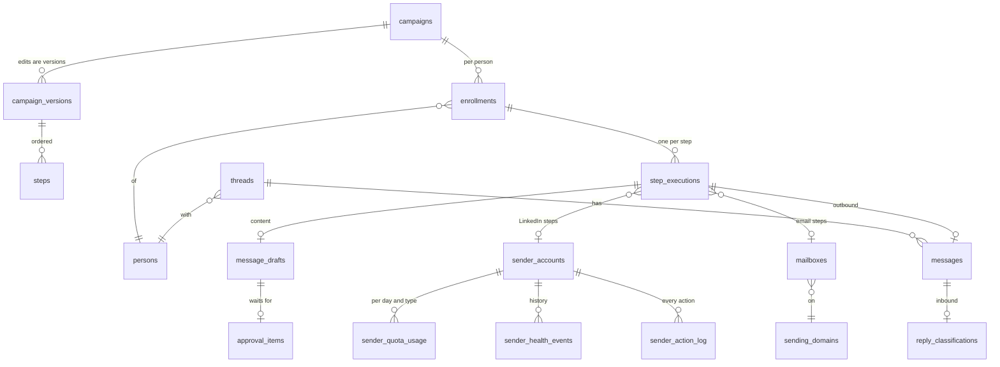

### [Privacy, integrations and platform](docs/architecture.md#75-privacy-integrations-and-platform)

The tables around them: erasure requests, consent and retention; integrations and webhooks fed from the outbox; idempotency records, jobs and feature flags.

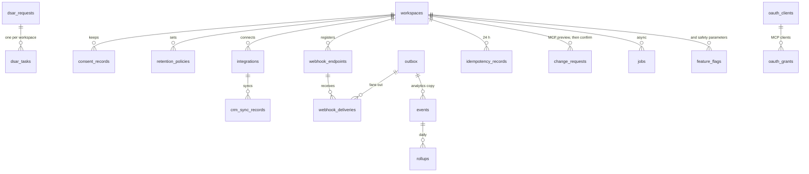

### [Background work: Temporal and Mastra](docs/architecture.md#8-background-work-temporal-and-mastra)

Temporal owns everything durable; Mastra runs one unit of AI work inside an activity. The second diagram is a qualification batch: credits reserved, the agents called, the score computed in code, the credits committed.

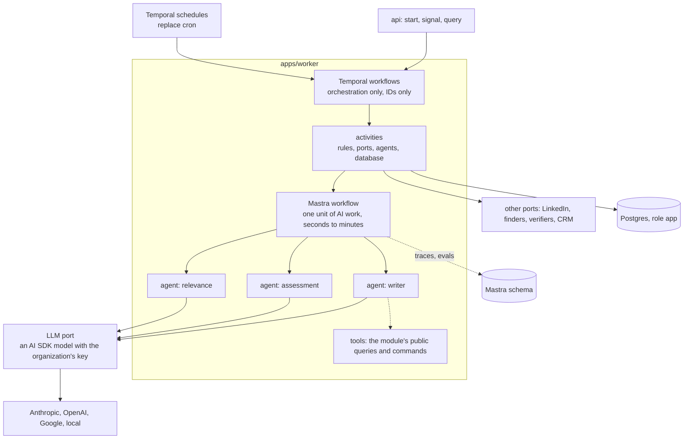

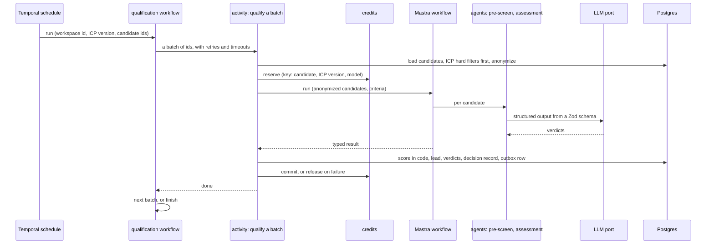

### [Ports and adapters](docs/architecture.md#9-ports-and-adapters)

Every external system sits behind a port in Whytide's own words, with one adapter per vendor folder, a fake for tests and one contract test suite for all of them. Replacing a vendor is a new folder and a configuration line.

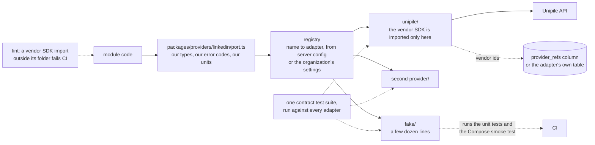

### [Signal run to qualified lead](docs/architecture.md#141-signal-run-to-qualified-lead)

A scheduled run reserves read quota and credits, reads a post's engagers through the LinkedIn port, and sends new people to qualification. Each source kind is a folder in one registry; post engagers is the first.

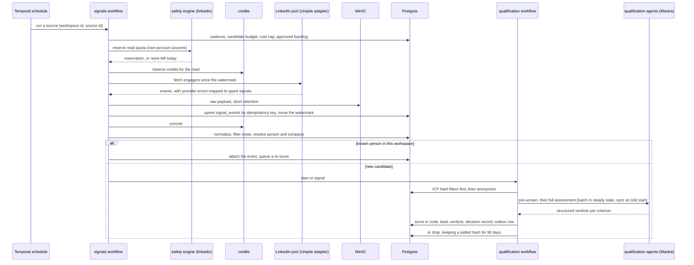

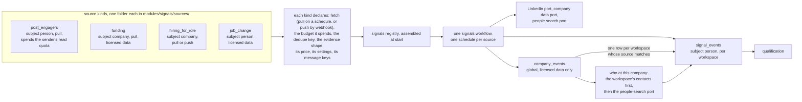

### [Approval to send, through both gates](docs/architecture.md#142-approval-to-send-through-both-gates)

After approval, every step passes the campaign's just-in-time checks, then the LinkedIn safety engine's quota and health checks, just before it runs. The state diagram is the life of one step.

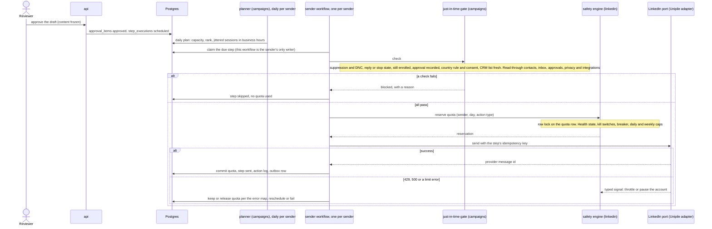

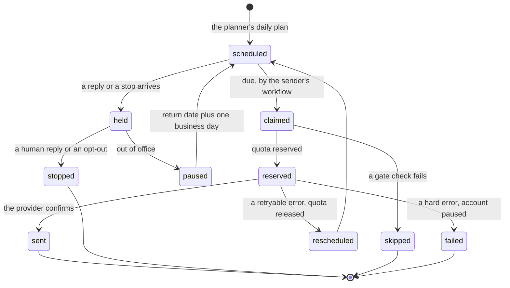

## Project structure

```
core/
  apps/              the hosts: they mount the modules and hold no feature code
    web/             Next.js: the screens
    api/             NestJS: mounts every module's API
    worker/          Temporal: registers every module's workflows, runs the agents
  modules/           one folder per feature, all the same shape
    tenancy/         users, organizations, workspaces and memberships
    identity/        invite-only sign-in
    onboarding/      Company Knowledge
    icp/             the ideal customer profile
    signals/         signal sources (LinkedIn post engagers) and their runs
    discovery/       lead import from a CSV file
    contacts/        people, companies and leads; the review; the never-contact list
    qualification/   hard filters, AI verdicts, the fit score and the tier
    messaging/       the facts a draft may use, and the AI writer
    linkedin/        connected accounts, quotas, account health, kill switches
    approvals/       the "Up next" approval queue
    campaigns/       the fixed sequence and the record of each step
    inbox/           replies, which stop the sequence
    credits/         the wallet, the plan and the metering
    privacy/         erasure on request
    _template/       the shape `pnpm module:new` copies
  packages/          what every module uses
    platform/        principal and permissions, config, ids, errors, logs, telemetry, i18n
    db/              Prisma: one schema file per module, migrations, database roles
    providers/       the ports and their adapters
    ai/              the Mastra setup, the agent task registry, evals
    ui/              shared components, the theme and shared messages
ee/                  the enterprise list: empty for now, and not under the Core license
deploy/              Compose for development and production, Dockerfile, Caddyfile, backup and restore
docs/                the architecture, the coding, security and delivery rules, the decision records
tools/               the lint rules, the CI runner, the module generator
tests/               the end-to-end test of the skeleton
api-calls/           sample HTTP requests for the API
```

Inside a module: `domain/` holds the rules in plain TypeScript, with `api/`, `workflows/`, `agents/`, `ui/`, `schemas/`, `messages/`, `docs/` and `tests/` around it. `index.ts` is the only entry other modules may import. Four registry files declare the module's permissions, prices, events and settings. Each module's `README.md` says what it owns.

## Run it

**Development.** You need Node 26, pnpm 10 or later (it switches to the version pinned in `package.json` by itself) and Docker with Compose.

```sh
pnpm install --frozen-lockfile
pnpm stack:up      # the development stack, in Docker
pnpm env:create    # this checkout's database, Temporal namespace, bucket and ports, in .env.local
```

The LinkedIn and LLM ports start on their fakes. To use the real ones, set `PROVIDER_LINKEDIN=unipile` and `PROVIDER_LLM=anthropic` in `.env.local`, with their keys on the lines marked `# secret`. Then start each host in its own terminal: `pnpm -F api dev`, `pnpm -F worker dev` and `pnpm -F web dev`. `pnpm invite` invites the first user. `pnpm build`, `pnpm typecheck`, `pnpm lint` and `pnpm test` run across every package. [AGENTS.md](AGENTS.md) lists every command.

**Self-hosting.** One Linux server with Docker runs Whytide from the same `compose.yaml`, in the `production` profile, with Caddy and automatic HTTPS. The steps are in [deploy/README.md](deploy/README.md), under "Production".

## Documentation

- [docs/architecture.md](docs/architecture.md): how Whytide is built, the one description. [docs/rules/](docs/README.md): the coding, security and delivery rules every change follows. [docs/adr/](docs/adr/): the decisions.
- Each module's `README.md` and `docs/`: what it owns, its routes, its screens and its decisions.
- [AGENTS.md](AGENTS.md): the brief for contributors and coding agents, with every command. [CONTRIBUTING.md](CONTRIBUTING.md): how a change gets in.
- [SECURITY.md](SECURITY.md): how to report a vulnerability, privately.

## License

Whytide Core is source-available under the Business Source License 1.1. [LICENSE.md](LICENSE.md) is the binding text; in short:

- Individuals and organizations with up to 3 employees and contractors, counting their affiliates, may use it in production for free. Larger organizations need a commercial license.
- Under this license, nobody may offer it, or a derivative of it, to third parties as a hosted or managed service.
- Anyone may use it for evaluation, development and testing.
- Each version becomes Apache 2.0 two years after its release.

`ee/` is not part of Core and not under this license.
