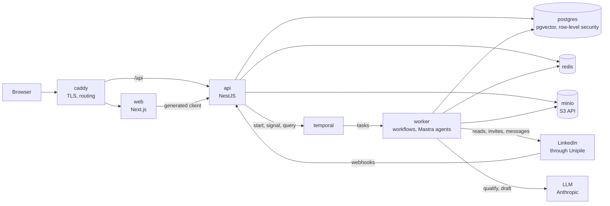

# Whytide

Whytide finds high-intent B2B leads on LinkedIn from buying signals, qualifies them with AI against your ideal customer profile, shows the evidence behind every lead, and sends outreach only after a person approves it. This repository holds the code of Whytide Core, the source-available, self-hosted edition, and of Whytide Cloud, the hosted service that runs the same code.

**Status:** this is the code at the end of beta, version 0.2.0, published to read. It is not a supported release yet.

## What it does

1. **Company Knowledge.** Paste your website: the AI drafts what you sell, to whom and why, and you edit it.
2. **Ideal customer profile.** Titles, seniorities, industries, company sizes and countries, plus must-haves and disqualifiers in plain text.
3. **Signals.** Point it at LinkedIn posts (yours, a competitor's, a creator's) and it reads the people who reacted or commented, through your own connected LinkedIn account. Or import a CSV of LinkedIn profiles.
4. **Qualification.** Hard filters in code first, then an AI verdict on each criterion with its evidence, then a fit score computed in code and a tier.
5. **Review.** The leads sorted by score, each with the post and what the person did on it. You mark each one Good lead or Not a fit.
6. **Outreach on LinkedIn.** Approving a lead starts one fixed sequence from your own account: a connection request, a first message once it is accepted, then two follow-ups. The AI drafts each message from the facts Whytide holds, and every message waits in "Up next" until you approve, edit or skip it.
7. **Safety.** Daily quotas inside your working hours, under hard maximums that no setting raises. Any reply stops the sequence. A never-contact list, opt-outs, and kill switches per account, per workspace and for the whole platform.
8. **Inbox.** The replies in the threads Whytide started.

## How it is built

- **A modular monolith in TypeScript.** One codebase and one Postgres database, run as three processes: `web`, `api` and `worker`.
- **Feature modules with enforced edges.** Every feature is a module of the same shape under `core/modules/`. The hosts in `core/apps/` hold no feature code. Modules meet only at their `index.ts`, the ports and events, and a lint rule fails CI on anything else.
- **Every external system behind a port.** LinkedIn goes through Unipile's hosted authentication, so Whytide never holds a LinkedIn password or cookie; the LLM through Anthropic; files through the S3 API; sign-in through Better Auth. Each port has a fake adapter for tests, and replacing a vendor is a new adapter folder and a configuration line.
- **Durable work in Temporal, AI work in Mastra inside it.** Postgres is the only source of truth, Redis can be wiped, and workflows carry IDs only.
- **The workspace is the data boundary.** Every tenant row carries its workspace, and Postgres row-level security fails closed.
- **Gates before every LinkedIn action.** A quota reservation and an account health check come first; suppression, reply state and approval are checked again just before the action runs. A retry never sends twice.
- **Credits meter every priced action**, such as reading a post's engagers, qualifying a lead or sending on LinkedIn, in Core too.
- **No hard-coded text.** Every string on a screen is a message key, ready for translation.



| Process | What it runs |
|---|---|
| `web` | Next.js (App Router): the screens, with the workspace in the URL. It reaches the API only through the generated client, never the database. |
| `api` | NestJS: the REST API, sign-in and the inbound webhooks. It runs the database migrations before it listens. |
| `worker` | The Temporal worker: workflows, activities, the Mastra agents and the outbox delivery. It has no inbound port. |
| `postgres` | The source of truth, with pgvector, and Temporal's databases. |
| `temporal` | Durable execution. |
| `redis` | Locks, rate limits and caches; nothing durable. |
| `minio` | Files, through the S3 API. |
| `caddy` | TLS and routing, in production. |

**Stack:** TypeScript on Node 26 with pnpm workspaces, Next.js with Tailwind CSS 4, NestJS, Prisma, Temporal, Mastra, PostgreSQL with pgvector, Redis, MinIO, Caddy, OpenTelemetry, Biome and Docker Compose.

[docs/architecture.md](docs/architecture.md) has the whole design, with a diagram for each part: processes, code layout, data, key flows, security and deployment.

## Project structure

```
core/
  apps/              the hosts: they mount the modules and hold no feature code
    web/             Next.js: the screens
    api/             NestJS: mounts every module's API
    worker/          Temporal: registers every module's workflows, runs the agents
  modules/           one folder per feature, all the same shape
    tenancy/         users, organizations, workspaces and memberships
    identity/        invite-only sign-in
    onboarding/      Company Knowledge
    icp/             the ideal customer profile
    signals/         signal sources (LinkedIn post engagers) and their runs
    discovery/       lead import from a CSV file
    contacts/        people, companies and leads; the review; the never-contact list
    qualification/   hard filters, AI verdicts, the fit score and the tier
    messaging/       the facts a draft may use, and the AI writer
    linkedin/        connected accounts, quotas, account health, kill switches
    approvals/       the "Up next" approval queue
    campaigns/       the fixed sequence and the record of each step
    inbox/           replies, which stop the sequence
    credits/         the wallet, the plan and the metering
    privacy/         erasure on request
    _template/       the shape `pnpm module:new` copies
  packages/          what every module uses
    platform/        principal and permissions, config, ids, errors, logs, telemetry, i18n
    db/              Prisma: one schema file per module, migrations, database roles
    providers/       the ports and their adapters
    ai/              the Mastra setup, the agent task registry, evals
    ui/              shared components, the theme and shared messages
ee/                  the enterprise list: empty for now, and not under the Core license
deploy/              Compose for development and production, Dockerfile, Caddyfile, backup and restore
docs/                the architecture, the coding, security and delivery rules, the decision records
tools/               the lint rules, the CI runner, the module generator
tests/               the end-to-end test of the skeleton
api-calls/           sample HTTP requests for the API
```

Inside a module: `domain/` holds the rules in plain TypeScript, with `api/`, `workflows/`, `agents/`, `ui/`, `schemas/`, `messages/`, `docs/` and `tests/` around it. `index.ts` is the only entry other modules may import. Four registry files declare the module's permissions, prices, events and settings. Each module's `README.md` says what it owns.

## Run it

**Development.** You need Node 26, pnpm 10 or later (it switches to the version pinned in `package.json` by itself) and Docker with Compose.

```sh
pnpm install --frozen-lockfile
pnpm stack:up      # the development stack, in Docker
pnpm env:create    # this checkout's database, Temporal namespace, bucket and ports, in .env.local
```

The LinkedIn and LLM ports start on their fakes. To use the real ones, set `PROVIDER_LINKEDIN=unipile` and `PROVIDER_LLM=anthropic` in `.env.local`, with their keys on the lines marked `# secret`. Then start each host in its own terminal: `pnpm -F api dev`, `pnpm -F worker dev` and `pnpm -F web dev`. `pnpm invite` invites the first user. `pnpm build`, `pnpm typecheck`, `pnpm lint` and `pnpm test` run across every package. [AGENTS.md](AGENTS.md) lists every command.

**Self-hosting.** One Linux server with Docker runs Whytide from the same `compose.yaml`, in the `production` profile, with Caddy and automatic HTTPS. The steps are in [deploy/README.md](deploy/README.md), under "Production".

## Documentation

- [docs/architecture.md](docs/architecture.md): how Whytide is built, the one description. [docs/rules/](docs/README.md): the coding, security and delivery rules every change follows. [docs/adr/](docs/adr/): the decisions.
- Each module's `README.md` and `docs/`: what it owns, its routes, its screens and its decisions.
- [AGENTS.md](AGENTS.md): the brief for contributors and coding agents, with every command. [CONTRIBUTING.md](CONTRIBUTING.md): how a change gets in.
- [SECURITY.md](SECURITY.md): how to report a vulnerability, privately.

## License

Whytide Core is source-available under the Business Source License 1.1. [LICENSE.md](LICENSE.md) is the binding text; in short:

- Individuals and organizations with up to 3 employees and contractors, counting their affiliates, may use it in production for free. Larger organizations need a commercial license.
- Under this license, nobody may offer it, or a derivative of it, to third parties as a hosted or managed service.
- Anyone may use it for evaluation, development and testing.
- Each version becomes Apache 2.0 two years after its release.

`ee/` is not part of Core and not under this license.
