# Architecture

| | |
|---|---|
| **Purpose** | The architecture we build, in one place: processes, code layout, data, flows, gates and rules, with a diagram for each. It consolidates the research architecture in docs/05 with the decisions taken since (docs/14, docs/15, docs/16, docs/17). Where the two differ, this document wins; §23 lists the differences. |
| **Audience** | Engineering and every contributor, human or AI coding agent. Each module's own `docs/` builds on this page instead of restating it. |
| **Status** | 2026-10-19. Decided, except the items in §22. docs/05 keeps the research: the options weighed, the capacity arithmetic and the sources. |
| **Related** | Roadmaps · Requirements briefs · Data model (requirements/05) · API spec (requirements/06) · Security briefs |
| **Planning repository** | docs/NN, the requirements, the briefs and the roadmaps named here live in the private planning repository, `whytide-docs`, so they appear without links. The rules every task follows are in [rules/](rules/coding.md). |

---

## Summary

- **A modular monolith.** One codebase and one Postgres, run as five process types: web, api, worker, and the admin pair on a private port. Anyone runs it with `docker compose up`; Cloud runs the same images with more configuration.
- **Feature modules with enforced edges.** The hosts contain no feature code. Modules meet only at `index.ts`, the ports and events; a lint rule fails CI on anything else.
- **Every external system behind a port.** Replacing a vendor is a new adapter folder and a config line.
- **Two gates on every outbound action.** The safety engine reserves quota and checks account health; the compliance gate re-checks suppression, reply state, approval, country rules and consent at execution. The app, the API, MCP and AI agents take the same path.
- **Durable work in Temporal, AI work in Mastra inside it.** Postgres is the only source of truth; Redis can be wiped; workflows carry IDs only.
- **The workspace is the data boundary.** Row-level security fails closed; two database roles bound what a bypass can do; the tenant API cannot write a plan or grant credits.
- **Credits meter every priced action in both editions.** Core seeds a plan at startup; Cloud adds a payment provider, Razorpay first.
- **Built to be read by attackers, by many contributors and in dozens of languages:** the security program in docs/17, docs that live with each module, no hard-coded UI text.

---

## 1. Principles

Twelve rules apply to every component. The first ten come from docs/05; the last two from the decisions on Core and Cloud.

| # | Rule | In practice |
|---|---|---|
| P1 | The workspace is the isolation boundary | `workspace_id` on every tenant row and in every unique key. Row-level security fails closed. Caches, file paths and rollups are split by tenant. Two-workspace tests run in CI |
| P2 | Durable, event-driven work | A stage writes its result and an outbox row in one transaction; the worker delivers the event. Temporal keeps multi-step work alive across restarts |
| P3 | Every step is idempotent | Keys on API requests, steps, credit reservations, AI calls and signal events. A retry never sends or charges twice |
| P4 | Every external system behind a port | Our types, one adapter per vendor folder, a registry, contract tests, a fake adapter (§9) |
| P5 | The safety engine is a mandatory gate | No LinkedIn or email action, read or write, without a quota reservation and a health check (§14.2) |
| P6 | Compliance is checked just in time | Suppression, DNC, reply state, enrolment, approval, country rule and consent are re-checked at execution, not only at planning |
| P7 | Every priced action is metered | Reserve credits, then commit or release. Every ledger row names the actor (§10) |
| P8 | Humans approve by default | Outreach waits for approval unless an Owner or Admin relaxes the mode. Code acts only on enumerated model outputs |
| P9 | Core paths never depend on optional parts | Suppression, stop and quotas keep working when Redis, the observability container, a data vendor or the LLM is down |
| P10 | Safety parameters are configuration | Limits, ramps, thresholds and kill switches change without a deploy, take effect within 5 minutes and are audited |
| P11 | Nothing in Core needs one cloud | Containers, Postgres, Redis, Temporal and the S3 API. A vendor-only service is at most an optional adapter |
| P12 | One codebase for Core and Cloud | Cloud is configuration of Core: a billing provider, the providers mode, the multi-organization flag, the `ee/` image and a license key |

---

## 2. System context

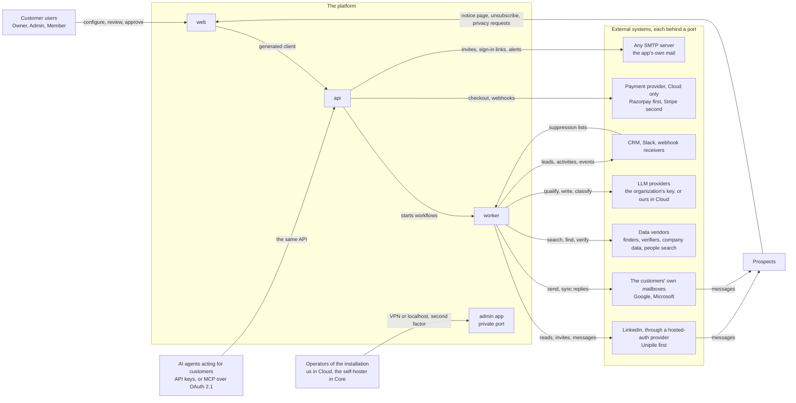

- LinkedIn only through hosted authentication. We never hold a password, a cookie or a second-factor secret.
- Outreach email goes only through the users' own mailboxes. The app's own mail goes through any SMTP server. No relay.
- Prospects reach only the public pages, which load no third-party scripts.
- A self-hoster brings their own keys for every provider. Cloud uses the same adapters with our contracts.

---

## 3. Processes

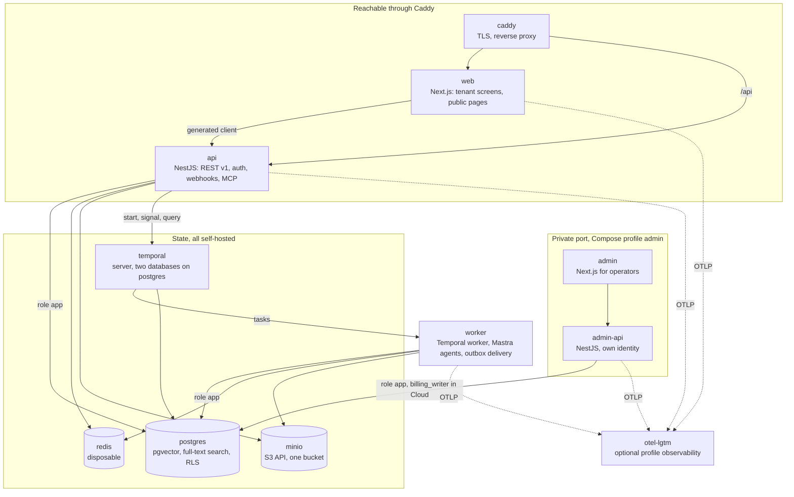

| Process | Image | Does | Reach |
|---|---|---|---|
| caddy | caddy | TLS and routing: `/api` to api, the rest to web. Never routes to the admin hosts | Public |
| web | ours | Next.js in standalone mode: tenant screens and the public pages. Talks to the API only through the generated client, never to the database | Behind caddy |
| api | ours | NestJS: REST v1, the auth handler, inbound webhooks, the MCP server from Core 1.1. Runs migrations and the plan seeder before it listens | Behind caddy |
| worker | ours | Temporal worker: workflows, activities, the Mastra agents, outbox delivery. The only process that decrypts provider tokens | No inbound port |
| admin, admin-api | ours | The operator app and its API, with their own identity and a second factor. The only application process that may hold `billing_writer` (§12) | Private port: VPN in Cloud, localhost in Core |
| temporal | temporalio/auto-setup | Durable execution. Two databases on the postgres service, no Elasticsearch | Internal |
| postgres | pgvector/pgvector | The source of truth: product tables under RLS, Temporal's databases, Mastra's schema | Internal |
| redis | redis or valkey | Locks, rate limits, caches, pub/sub. Can be wiped | Internal |
| minio | minio/minio | Files through the S3 API, paths prefixed by workspace | Internal |
| temporal-ui, otel-lgtm, mailpit | third-party | Profiles `tools`, `observability`, `dev` | Internal |

One worker is enough through V1. More capacity is the same worker image, started again. The sizing aim for a self-hoster is 2 CPUs and 4 GB without the observability profile.

---

## 4. The code

### 4.1 Workspace layout

```
repo/
  core/
    apps/web            Next.js host for tenants
    apps/admin          Next.js host for operators
    apps/api            NestJS host: mounts the modules' API
    apps/admin-api      NestJS host: mounts the modules' admin/ folders
    apps/worker         Temporal host: registers the modules' workflows, runs the agents
    modules/<name>      one per feature (§4.2)
    packages/platform   principal and permissions, the credits client, events, config, ids, the i18n runtime
    packages/db         Prisma: one schema file per module, migrations, policies, database roles
    packages/providers  the ports and their adapters (§9)
    packages/ai         the Mastra setup, the LLM port glue, the task registry, shared tools, the eval runner
    packages/ui         shared components, design tokens, shared messages
  ee/modules/<name>     same shape; attaches at the three extension points
  deploy/               compose.yaml, Caddyfile, .env.example, backup and restore scripts
  docs/                 app-level docs and adr/
```

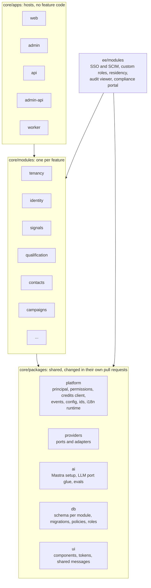

Three rules:

1. A module's `domain/` imports nothing from NestJS, Next.js, Temporal or Mastra. The rules run in plain unit tests, and the same code serves the API and the worker.
2. Workflows contain orchestration only. Activities call the module's rules, its agents and the ports.
3. `ee/` imports `core/`, never the reverse. Core images contain no `ee/` code.

### 4.2 Inside a module

Every module has the same shape, so a contributor who has read one can read all of them (docs/16 §1):

```
core/modules/contacts/
  README.md        what it owns, its public interface, who reviews it
  AGENTS.md        the brief a coding agent reads first
  index.ts         the public interface: types, queries, commands, events
  domain/          the rules, plain TypeScript
  schemas/         Zod request and response schemas
  api/             NestJS controllers and services
  admin/           operator endpoints and screens
  workflows/       Temporal workflows and activities
  agents/          agent tasks and their prompts, on @whytide/ai, never @mastra/*
  ui/              Next.js route segments and components
  messages/        en.json and the other languages, ICU syntax
  docs/            concepts, data, flows, runbook, security
  permissions.ts   prices.ts   events.ts   settings.ts   mcp.ts
  tests/
```

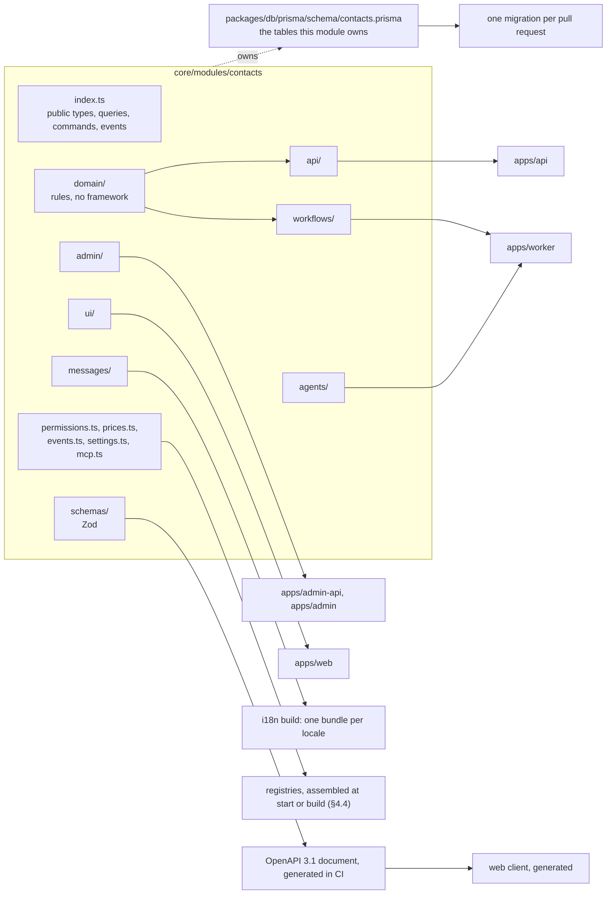

The hosts mount what the folder exports. Their module lists are generated at build from the folder, never committed.

### 4.3 How modules talk

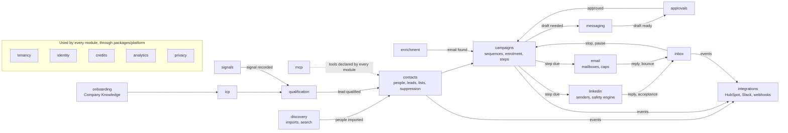

The six boundary rules (docs/16 §2):

1. A module imports another module only through its `index.ts`.
2. It reads another module's data through that module's public queries, and changes it only through public commands or by publishing an event. No module writes a table it does not own.
3. Modules depend on `platform`, `providers`, `ai` and `db`. Never on the hosts, never on each other's internals.
4. Events are written in the same transaction as the change (the outbox table) and delivered by the worker.
5. A lint rule enforces rules 1 to 3 in CI.
6. A cross-cutting change goes to `platform`, `providers`, `ai` or `ui` in its own pull request first.

### 4.4 Registries, not switchboards

Anything that lists "all the X" is assembled from one file per module, so two pull requests never edit the same line.

| List | Each module declares it in | Assembled by |
|---|---|---|
| Permission actions, deny-list codes | `permissions.ts` | `platform`, at start |
| Prices | `prices.ts` | the credits module, at start |
| Events and the webhook catalogue | `events.ts` | `platform`; the OpenAPI components |
| API routes; operator routes | `api/`; `admin/` | the hosts, from a generated list |
| Workflows and activities | `workflows/` | the worker, from a generated list |
| Screens and navigation | `ui/` with a `nav.ts` entry | the web host |
| Messages | `messages/<locale>.json` | the i18n build, per locale |
| Settings and provider keys | `settings.ts` | the settings screen |
| MCP tools | `mcp.ts` | the mcp module |
| Signal source kinds | `modules/signals/sources/<kind>/` | the signals module, at start (§14.1) |
| Tables | `packages/db/prisma/schema/<module>.prisma` | Prisma |

---

## 5. A request, end to end

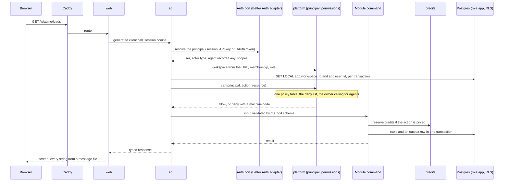

Every request resolves to a **principal**: the user it acts for, the actor type, the agent record if any, the authentication method and the scopes. One function decides every action from one policy table, for the web app, the API, MCP and agents alike. There is no UI-only endpoint.

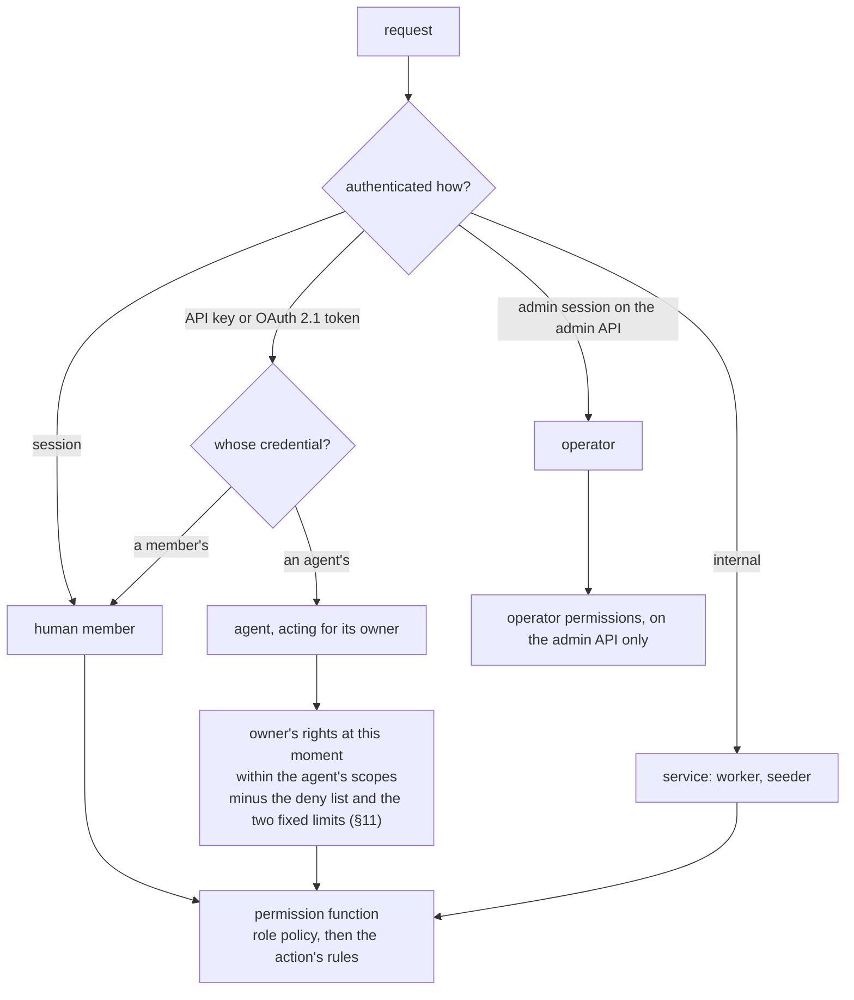

---

## 6. Tenancy and isolation

The database enforces isolation, so application discipline is not the only line of defense. Data lives in three scopes.

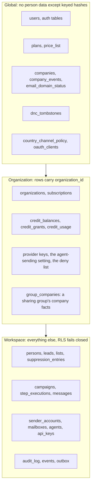

- **Policy:** `USING (workspace_id = current_setting('app.workspace_id'))`. Without a context, a query returns nothing. The context is set with `SET LOCAL` inside each transaction, so a pooled connection never leaks it.
- **The `app` role** is neither table owner nor superuser. CI checks that every tenant table has `workspace_id` and a policy, and runs two-workspace isolation tests.
- **Cross-tenant jobs** (DNC matching, ledger reconciliation, erasure lookups, fleet telemetry, the company-index refresh) use narrow roles with grants on the named tables only.
- **Organization-level data** (the wallet, provider keys, settings) matches on `organization_id`. Organization-level suppression (Cloud 2) applies to every workspace in the organization.
- **Sharing groups** (gamma-rf-010): a company's facts that an organization's own accounts, imports and vendors found sit in `group_companies`, keyed by `sharing_group_id`, today the organization's id (tenancy's `sharingGroupOf()`); the global `companies` holds only what a shared class found (open data and websites by default, contacts' `CONTACTS_SHARED_FACT_SOURCES`), and a CHECK refuses any other class. Neither table has `workspace_id`: contacts alone queries them, in the caller's run, with the run's group, never one a caller names, and `app` holds no DELETE on them.
- **Growth:** `workspace_id` on every row is what allows sharding by workspace later. Nothing in Core needs it.

| Role | Used by | Can | Cannot |
|---|---|---|---|
| `app` | api, worker, admin-api by default | Read and write tenant rows under RLS. Read plans, subscriptions and grants. Insert and update usage rows | Write a plan, a subscription or a grant. Read rows outside the tenant context |
| `billing_writer` | The seeder at start; the signed billing webhook on its own connection (Cloud); the renewal function; admin-api in Cloud | Write plans, subscriptions and grants | Anything else |
| Narrow cross-tenant roles | The jobs above | The named tables, without a tenant context | The rest |
| Owner | Migrations at start | DDL | Serve a request |

---

## 7. Data

### 7.1 Where state lives

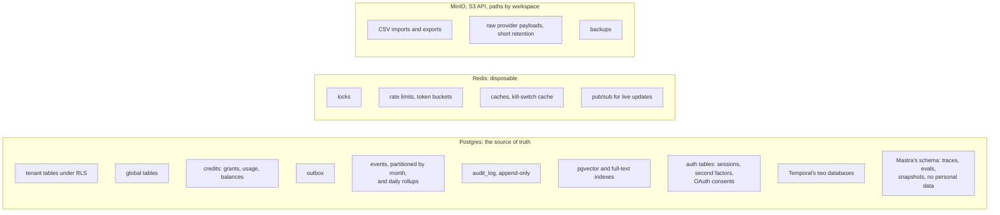

No warehouse, no search cluster, no vector database, no cloud key store. Events and rollups live in Postgres; dashboards read the rollups and never scan raw events at request time. Revisit at Cloud 2 if the event table passes about 100 million rows a month (docs/15 §6).

### 7.2 Tenancy, identity and credits

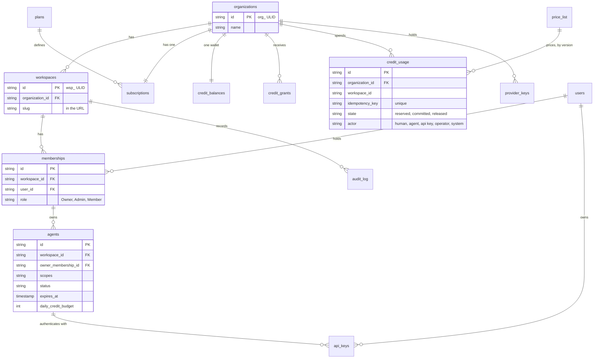

### 7.3 Signals, people and leads

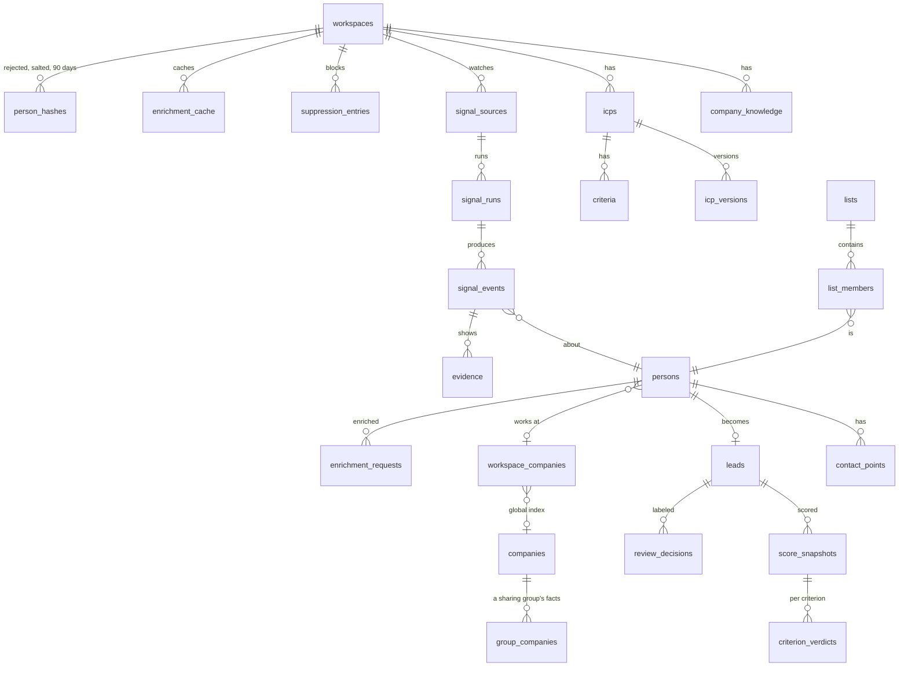

### 7.4 Campaigns, senders and inbox

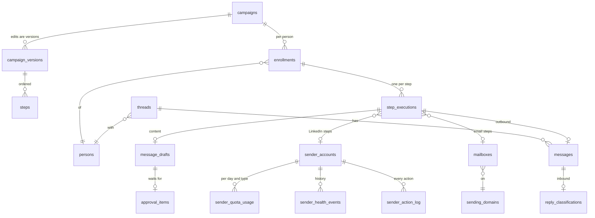

### 7.5 Privacy, integrations and platform

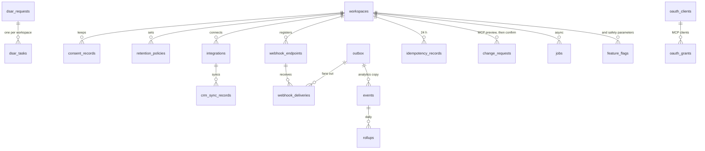

The full catalog, with every field, state and retention clock, is the data model (requirements/05). The table names above are the module-owned Prisma names; the catalog's entity names map onto them one to one.

### 7.6 Physical rules

- **IDs** are prefixed, time-sortable ULIDs (`wsp_…`, `per_…`). **Timestamps** are UTC.
- **Partitions** by month for `step_executions`, `signal_events`, `messages`, `audit_log` and `events`. Retention runs as partition drops.
- **The outbox:** a write that other modules or systems must see adds an outbox row in the same transaction. The worker delivers it; consumers dedupe by event id.
- **What Prisma cannot say** (policies, partitions, pgvector and full-text indexes, triggers, roles) is hand-written SQL inside the same migration, with a comment in the schema file pointing at it. One migration per pull request, named `<module>_<change>`.
- **Migrations** run on start, expand first, and stay compatible with the previous release.
- **Raw provider payloads** go to MinIO with a short lifecycle (72 hours for person-level payloads, 30 days for company-level, both pending counsel). Rejected candidates persist only as salted hashes for 90 days.
- **Vectors** (Company Knowledge chunks, title normalization, lookalikes later) are pgvector columns, stored per tenant.
- **Reads:** just-in-time checks read the primary. Exports, indexing and reports may read a replica in Cloud.

---

## 8. Background work: Temporal and Mastra

Temporal owns everything durable. Mastra owns the AI work inside one unit of it.

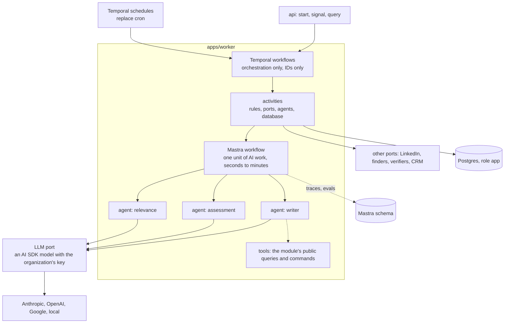

| Temporal owns | Mastra owns |
|---|---|
| Anything that waits, retries across restarts, fans out or runs on a schedule: signal runs, qualification batches, sequences and their timers, inbox sync, enrichment waterfalls, erasure fan-out, retention timers, credit renewals, rollups, reconciliation, webhook delivery | The AI work inside one activity: one or many agents with tools, returning a Zod-typed result |
| Retries, timeouts and heartbeats around every Mastra call | Prompts, tools, structured output, evals, traces |
| Workflow state, which carries IDs and never personal data | Its own schema (`@mastra/pg`): traces, evals, snapshots. No personal data, because the input has none |

Rules (docs/15 §14):

1. Agents live in their module's `agents/` folder with their prompts. The rest of the module calls an agent through a plain function with Zod input and output. Only `core/packages/ai` imports Mastra; a task file in `agents/` imports `@whytide/ai`.
2. Models come through the LLM port, so bring-your-own-model keeps working.
3. Agents see anonymized, delimited input and return structured output. Mastra's memory stays off; context comes from our tables, per call. The model never sees a name, a photo or pronouns during qualification.
4. Agents run in the worker. The API never calls a model. A tool that changes data goes through the module's public commands, so permission and credit checks apply.
5. Evals in `packages/ai` run in CI for every changed prompt; traces go to the local backend.
6. Versions are pinned. One agent per job, composed by workflows.

**What docs/05 called the LLM gateway** is `packages/ai` around the LLM port: the task registry (model, prompt version, schema, budget per task), the result cache keyed by task, subject, input hash, model and prompt version, batch or synchronous mode, the output validation with one retry, and the decision record and cost event per call.

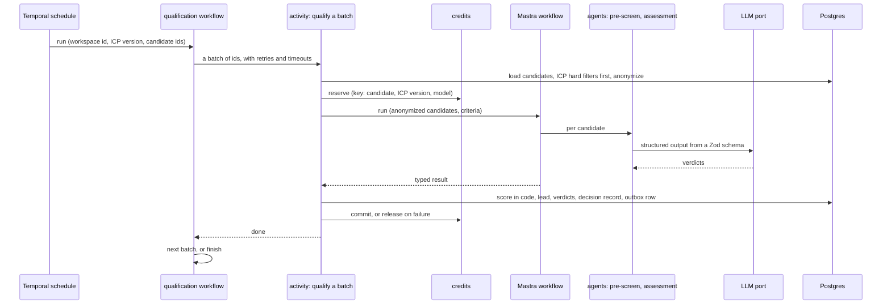

**Schedules** replace every cron job: the cadence per signal source, qualification batches, the daily plan per sender, inbox reconciliation, retention timers, the credit renewal per period, daily rollups, the nightly ledger reconciliation, the hourly CRM suppression pull, re-embedding.

---

## 9. Ports and adapters

The product talks to a **port** we define; a **provider** implements it in an **adapter**. Built this way from the first adapter in alpha, never retrofitted.

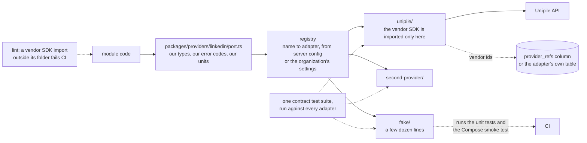

| Port | First adapter | Later | Chosen by |
|---|---|---|---|
| Authentication | Better Auth (proposed) | Any other library | Server config |
| Billing | None: the seeded plan | Razorpay, then Stripe | Server config |
| LLM | Anthropic through the AI SDK | OpenAI, Google, local models | Organization settings |
| LinkedIn hosted auth | Unipile | A second provider | Organization settings |
| Email finder; email verifier | One each | More on request | Organization settings |
| Mailboxes | Google, Microsoft | SMTP and IMAP | Per sender |
| Company data; people search | One vendor each | More | Organization settings |
| CRM | HubSpot | Salesforce, Pipedrive | Organization settings |
| Alerts | Slack | Teams, email | Organization settings |
| Files | MinIO, through the S3 API | Any S3-compatible store | Server config |
| App mail | SMTP | | Server config |
| Key management | The app master key | A cloud key service | Server config |

Six rules, each enforced by a tool (docs/15 §10):

1. The port is written in our words. A vendor's object never crosses it.
2. One adapter per folder; the vendor SDK is imported only there.
3. A registry maps names to adapters; nothing else knows which one runs.
4. Every adapter passes the same contract tests. The fake adapter runs the whole suite.
5. Vendor ids live in `provider_refs` or the adapter's own table, never in domain columns.
6. Adding a provider is a folder, a registry entry and a docs page. Replacing one adds a migration of its `provider_refs`.

**Authentication** is the same pattern. The API depends on one port: resolve the principal, sign out everywhere, revoke a user, issue an invite, report whether a second factor is enrolled. Better Auth mounts under `/api/auth` from one folder. We own `users`, `organizations`, `workspaces`, `memberships`, `agents` and `api_keys`; the library owns sessions, OAuth links, password hashes (argon2id), second factors, passkeys and the OAuth clients and consents for MCP. `ee/` adds SSO at this port (docs/15 §5).

---

## 10. Credits

The credit system is Core and behaves the same in both editions. Only the payment provider differs.

- An organization has one subscription to one plan. A plan has a monthly allowance, limits and, in Cloud, prices.
- Credits sit in **one wallet per organization**, shared by its workspaces.
- Every priced action **reserves first, commits on success and releases on failure**, with an idempotency key. The balance is grants minus committed usage, kept in a balance row by a trigger, so a check is one read.
- Tables: `plans`, `subscriptions`, `credit_grants`, `credit_usage`, `credit_balances`, `price_list`. Append-only, except the balance row and a reservation's state.

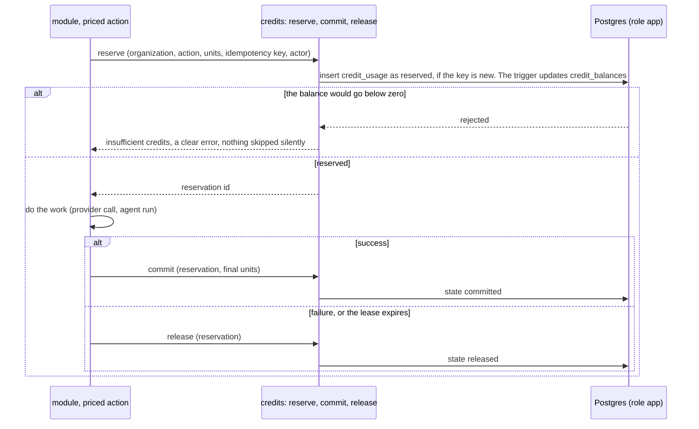

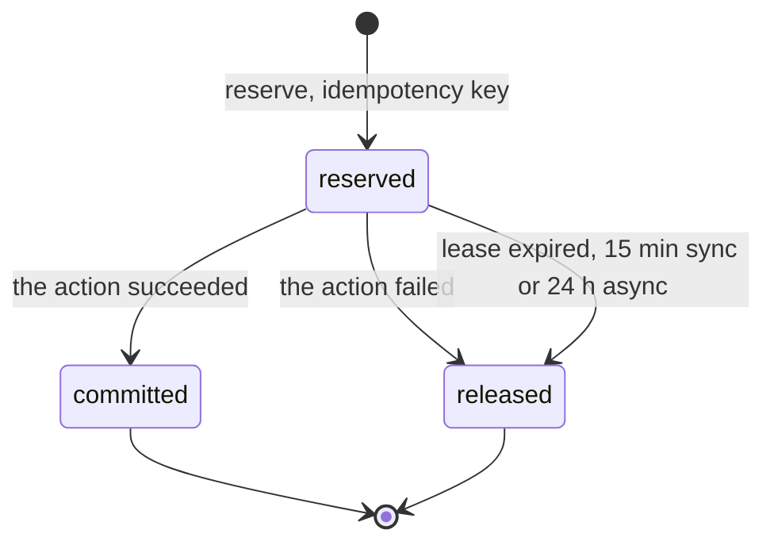

**Self-hosted (Core):** a built-in plan `self_hosted` with no hard limits. `.env` sets the monthly allowance, 10 million credits by default. After start, the allowance changes in `.env` with a restart, or with SQL on the server using the `billing_writer` credentials, wrapped in a documented ops command. Prices, alerts and the ledger run exactly as in Cloud; no money moves.

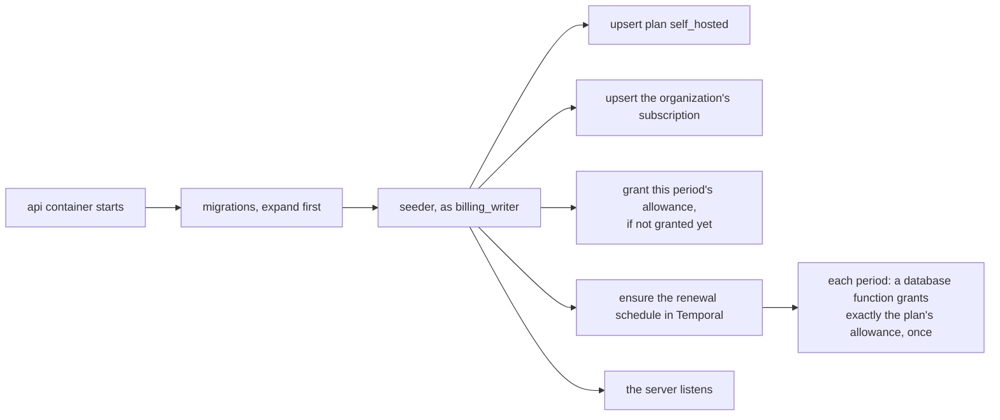

**Cloud:** the billing port with the Razorpay adapter first and Stripe second: customer, checkout, portal, plan change, cancel, and webhook parsing into our own event types. Plans map to provider price ids in config. Our tables stay the source of truth; the provider moves money and reports status.

**Why nothing in the tenant API can change a plan or grant credits:** if someone gets past the API's authorization, what they can do must stay bounded.

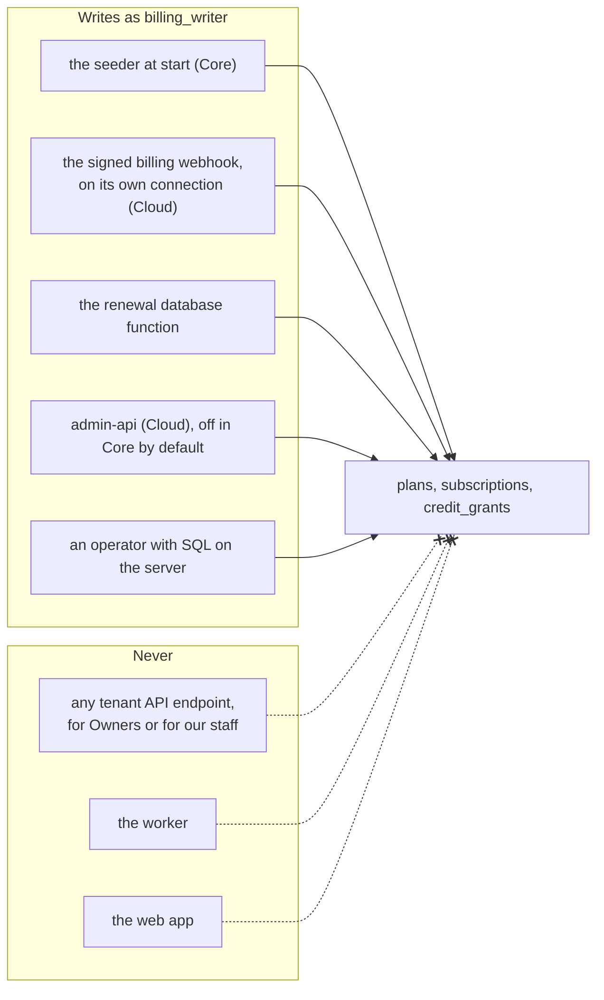

Every grant is audited with its source: seed, webhook event id, renewal period or operator.

---

## 11. AI agents as users

An AI agent acting for a customer can do what a human member can, through the same API, except what the organization reserves for humans (docs/15 §12). An agent is a record in the workspace: name, owner, scopes, status, expiry, last use, an optional IP allow-list and a daily credit budget. It authenticates with an API key or, as an MCP client, with OAuth 2.1.

```mermaid
flowchart TB
  CALL["agent call: API key or MCP"] --> ALIVE{"agent active, not expired,<br/>owner still a member with that role?"}
  ALIVE -->|"no"| DENY["deny, with a machine code"]
  ALIVE -->|"yes"| KILL{"organization kill switch off?"}
  KILL -->|"no"| DENY
  KILL -->|"yes"| FIXED{"touches agents, API keys, scopes,<br/>the deny list or the sending setting?"}
  FIXED -->|"yes"| DENY
  FIXED -->|"no"| OWNER{"may the owner do it, right now?"}
  OWNER -->|"no"| DENY
  OWNER -->|"yes"| SCOPE{"within the agent's scopes?"}
  SCOPE -->|"no"| DENY
  SCOPE -->|"yes"| LIST{"on the deny list,<br/>for the organization or this agent?"}
  LIST -->|"yes"| DENY
  LIST -->|"no"| BUDGET{"daily requests and<br/>credit budget left?"}
  BUDGET -->|"no"| DENY
  BUDGET -->|"yes"| SEND{"an outbound send?"}
  SEND -->|"yes"| SET{"the sending setting"}
  SET -->|"nothing"| DENY
  SET -->|"drafts, the default"| QUEUE["draft to the approval queue"]
  SET -->|"direct"| DIRECT["send with the AI disclosure,<br/>through every gate of §14.2"]
  SEND -->|"no"| BULK{"destructive or bulk write?"}
  BULK -->|"yes"| PREVIEW["preview, then confirm,<br/>or a human confirms in the approval queue"]
  BULK -->|"no"| RUN["run the command, attributed<br/>to the agent and its owner"]
```

- **Two limits nobody can remove:** an agent never has more rights than its owner has at that moment, and an agent never creates or changes agents, API keys, scopes, the deny list or the sending setting.
- **The deny list is the organization's.** Owners and Admins edit it in the app, for the organization or for one agent, in both directions. Server config supplies only the defaults a new organization starts with (the table in docs/15 §12).
- **Sending is a setting:** nothing; drafts to the approval queue (the default); or direct sends with the AI disclosure and every check the app's own automation passes.
- **Built in from the start:** attribution on every action, ledger row and audit event (actor type, agent, owner, client name); an organization-wide kill switch; daily request and credit budgets with a clear error when exhausted; key expiry (90 days), rotation, last-used, IP allow-lists and revocation when the owner leaves; everything an agent reads is data, never instructions.
- **When:** the principal shape and the permission function from alpha; roles in gamma; agent records, the deny list, the sending setting and budgets with the API and MCP in Core 1.1.

---

## 12. The admin app

The hosting owner, us in Cloud and the self-hoster in Core, manages the installation from a separate app, never from the tenant web app.

```mermaid
flowchart LR
  OP["operator"] -->|"VPN in Cloud, localhost in Core,<br/>a second factor, SSO with hardware keys in Cloud"| ADM["admin<br/>Next.js, private port"]
  ADM --> AAPI["admin-api<br/>NestJS, private port,<br/>its own instance of the auth port"]
  AAPI --> MODADM["modules/*/admin/<br/>operator endpoints and screens"]
  MODADM --> PG[("Postgres<br/>role app, and billing_writer in Cloud")]
  AAPI --> AUD["audit_log<br/>actor type operator"]
  CADDY["caddy"] -.-x ADM
  TAPI["tenant api"] -.-x AAPI
```

- **Two more hosts, the same modules.** A module keeps its operator work in its own `admin/` folder; the admin hosts mount it. No feature code is written twice.
- **Its own door:** a separate process on its own port, outside Caddy's routes, on the `admin` Compose profile. A bug in the tenant API cannot reach it: different process, port and network.
- **Its own identity:** operators are not tenant users. The actor type is `operator`, and every operator action lands in the append-only audit log.
- **Its own database role:** the one application process that may hold `billing_writer`. In Core its billing writes are off by default.
- **What it manages:** organizations; subscriptions and grants (Cloud); bundled-provider contracts and usage; fleet safety (the circuit breaker, limits tuned from fleet data, remote configuration); support access as time-boxed, customer-approved grants; sign-up protection; feature flags; `ee/` license keys; privacy requests at the processor level; health, backups and upgrades; the license page in Core; the operator audit log.
- **When:** the hosts at zeta with health, the license page, provider usage and backup status; the operations screens with Cloud 1.

---

## 13. API, webhooks and MCP

```mermaid
flowchart LR
  subgraph CLIENTS["Clients"]
    WEBC["web app<br/>generated client"]
    KEYS["API keys<br/>members and agents"]
    MCPC["MCP clients<br/>OAuth 2.1"]
    EXT["browser extension<br/>later"]
  end
  WEBC --> API
  KEYS --> API
  MCPC --> API
  EXT --> API
  API["api: one REST API v1<br/>OpenAPI 3.1 from the Zod schemas<br/>Idempotency-Key kept 24 h<br/>rate limits per key and per workspace"]
  API --> MCPS["mcp module<br/>tools from every module's mcp.ts<br/>preview, then confirm"]
  API --> OUT[("outbox")]
  OUT --> DELIV["worker: webhook delivery<br/>signed, retried for 24 h"]
  DELIV --> RECV["webhook receivers"]
  OUT --> INT["integrations: HubSpot push, Slack alerts"]
  PROV["provider webhooks<br/>Unipile, mailboxes, billing"] -->|"200 at once, verify, process later"| API
```

- **One API.** The web app calls the same endpoints as API keys, MCP clients and agents. Scoped keys, shown once and stored hashed; separate rate budgets for REST and MCP; machine error codes that the UI translates.
- **Webhooks out** are signed, retried for 24 hours, and carry ids only for erased people (`contact.erased`).
- **MCP** runs inside the API over streamable HTTP with OAuth 2.1. Writes return a preview and act on confirm (`change_requests`). Sends follow the agent-sending setting (§11); approving a draft stays human-only by the default deny list.
- **When:** webhooks at zeta; the public API and MCP in Core 1.1; the extension later.

---

## 14. Key flows

Six flows carry most of the risk. Each diagram shows the main path and the main safety branch.

### 14.1 Signal run to qualified lead

```mermaid
sequenceDiagram
  participant SCH as Temporal schedule
  participant WF as signals workflow
  participant SAFE as safety engine (linkedin)
  participant CR as credits
  participant LIP as LinkedIn port (Unipile adapter)
  participant S3 as MinIO
  participant DB as Postgres
  participant QWF as qualification workflow
  participant AG as qualification agents (Mastra)
  SCH->>WF: run a source (workspace id, source id)
  WF->>DB: cadence, candidate budget, cost cap, approved backlog
  WF->>SAFE: reserve read quota (own-account sources)
  SAFE-->>WF: reservation, or none left today
  WF->>CR: reserve credits for the read
  WF->>LIP: fetch engagers since the watermark
  LIP-->>WF: events, with provider errors mapped to typed signals
  WF->>S3: raw payload, short retention
  WF->>DB: upsert signal_events by idempotency key, move the watermark
  WF->>CR: commit
  WF->>DB: normalize, filter noise, resolve person and company
  alt known person in this workspace
    WF->>DB: attach the event, queue a re-score
  else new candidate
    WF->>QWF: start or signal
    QWF->>DB: ICP hard filters first, then anonymize
    QWF->>AG: pre-screen, then full assessment (batch in steady state, sync at cold start)
    AG-->>QWF: structured verdicts per criterion
    QWF->>DB: score in code, lead, verdicts, decision record, outbox row
    QWF->>DB: or drop, keeping a salted hash for 90 days
  end
```

- Budgets bound each run: 500 candidates per seat a day, vendor rate limits and cost caps, and the sender's read quota, since own-account reads count against it.
- Hard filters run before any model call. AI calls are idempotent per candidate, ICP version and model version. Anything the model cannot judge is "needs review", never admitted on its own.
- Cold start runs synchronously so a new workspace sees a first qualified lead within 2 hours. Steady state uses batch mode.

**Source kinds.** Alpha has one kind of source, post engagers on LinkedIn. More follow: job boards for hiring events, funding, job changes, technology (the 15 MVP signal types of RB-4.1.4). The signals module is built as a registry from the first kind, so each later kind is a folder.

```mermaid
flowchart LR
  subgraph KINDS["source kinds, one folder each in modules/signals/sources/"]
    K1["post_engagers<br/>subject person, pull,<br/>spends the sender's read quota"]
    K2["funding<br/>subject company, pull,<br/>licensed data"]
    K3["hiring_for_role<br/>subject company,<br/>pull or push"]
    K4["job_change<br/>subject person,<br/>licensed data"]
  end
  KINDS --> DECL["each kind declares: fetch (pull on a schedule, or push by webhook),<br/>the budget it spends, the dedupe key, the evidence shape,<br/>its price, its settings, its message keys"]
  DECL --> REG["signals registry, assembled at start"]
  REG --> WF["one signals workflow,<br/>one schedule per source"]
  WF --> PORTS["LinkedIn port, company data port,<br/>people search port"]
  WF --> PE["signal_events<br/>subject person, per workspace"]
  WF --> CE["company_events<br/>global, licensed data only"]
  CE -->|"one row per workspace<br/>whose source matches"| PE
  CE --> WHO["who at this company:<br/>the workspace's contacts first,<br/>then the people-search port"]
  WHO --> PE
  PE --> QUA["qualification"]
```

1. A source kind is a folder. Adding one touches no shared file (§4.4). There is no central enum of signal types.
2. A kind names its subject, a person or a company. Person signals go straight to qualification. Company signals need one more step, who at this company, answered from the workspace's own contacts first and then from the people-search port. In Core without a people-search key, a company signal shows on the account with no people, and the screen says so.
3. Only licensed data (acquisition mode B) lands in the global `company_events`; the adapter's licence flags gate storage. Anything observed through a user's own account stays in workspace tables.
4. Only own-account kinds spend the sender's read quota. Vendor kinds spend credits and the provider's monthly cap.
5. The kind owns its evidence shape (RB-4.4.3) and the one-line rendering of it, in its own message keys.

### 14.2 Approval to send, through both gates

```mermaid
sequenceDiagram
  actor REV as Reviewer
  participant API as api
  participant DB as Postgres
  participant PLAN as planner (campaigns), daily per sender
  participant SWF as sender workflow, one per sender
  participant GATE as just-in-time gate (campaigns)
  participant SAFE as safety engine (linkedin)
  participant LIP as LinkedIn port (Unipile adapter)
  REV->>API: approve the draft (content frozen)
  API->>DB: approval_items approved, step_executions scheduled
  PLAN->>DB: daily plan: capacity, rank, jittered sessions in business hours
  SWF->>DB: claim the due step (this workflow is the sender's only writer)
  SWF->>GATE: check
  Note over GATE: suppression and DNC, reply or stop state, still enrolled, approval recorded, country rule and consent, CRM list fresh. Read through contacts, inbox, approvals, privacy and integrations
  alt a check fails
    GATE-->>SWF: blocked, with a reason
    SWF->>DB: step skipped, no quota used
  else all pass
    SWF->>SAFE: reserve quota (sender, day, action type)
    Note over SAFE: row lock on the quota row. Health state, kill switches, breaker, daily and weekly caps
    SAFE-->>SWF: reservation
    SWF->>LIP: send with the step's idempotency key
    alt success
      LIP-->>SWF: provider message id
      SWF->>DB: commit quota, step sent, action log, outbox row
    else 429, 500 or a limit error
      LIP-->>SAFE: typed signal: throttle or pause the account
      SWF->>DB: keep or release quota per the error map, reschedule or fail
    end
  end
```

- **Planning:** a jittered daily schedule per sender, 4 to 8 sessions of 3 to 12 actions, in business hours, with causal delays. Priority: replies, follow-ups, invites, signal reads, imports.
- **One writer per sender:** the sender's workflow id is the sender id, so Temporal runs exactly one. A worker that dies mid-call checks the provider (sent invites, chat history, the sent folder by our Message-ID) before any retry. A provider 500 pauses the account and is never retried in a loop.
- **Email takes the same path** through Gmail or Microsoft Graph: 25 sends a day per mailbox (hard cap 50), 75 per domain (hard cap 150), 4 to 12 minutes apart.

```mermaid
stateDiagram-v2
  [*] --> scheduled : the planner's daily plan
  scheduled --> held : a reply or a stop arrives
  scheduled --> claimed : due, by the sender's workflow
  claimed --> skipped : a gate check fails
  claimed --> reserved : quota reserved
  reserved --> sent : the provider confirms
  reserved --> rescheduled : a retryable error, quota released
  reserved --> failed : a hard error, account paused
  rescheduled --> scheduled
  held --> paused : out of office
  held --> stopped : a human reply or an opt-out
  paused --> scheduled : return date plus one business day
  sent --> [*]
  stopped --> [*]
  skipped --> [*]
  failed --> [*]
```

### 14.3 Inbound reply: stop, classify, draft

```mermaid
sequenceDiagram
  participant SRC as Unipile or a mailbox API
  participant API as api, webhook receiver
  participant WF as inbox workflow
  participant DB as Postgres
  participant AG as inbox agents (Mastra)
  participant SUP as suppression (contacts)
  participant OWN as lead owner
  SRC->>API: new message event
  API-->>SRC: 200 at once, after verifying the secret
  API->>WF: start, deduped by provider message id
  WF->>DB: store the message, match the thread to a person
  WF->>DB: same transaction: hold every pending step for this person
  Note over WF,DB: stop first, with no model in this path. Within 60 s of sync
  WF->>AG: classify, with the full thread
  AG-->>WF: label, confidence, entities
  alt opt-out or hostile, at any confidence
    WF->>SUP: suppress on all channels (99 percent within 1 h)
  else out-of-office
    WF->>DB: the hold becomes a pause until the return date plus 1 business day
  else other human reply
    WF->>DB: the hold becomes a stop, label set (suggested below 0.7)
    WF->>AG: draft a reply, same quality gates
    AG-->>WF: draft within 10 s
  end
  WF->>OWN: notify. The draft waits for a human
  WF->>DB: outbox row for webhooks, CRM and analytics
```

- The hold is written with the message, so the stop never waits for a model and survives a classification failure.
- Targets: 95 percent of inbound messages synced within 2 minutes; the sequence stops within 60 seconds of sync; 99 percent of opt-outs suppressed within 1 hour; drafts within 10 seconds.
- Drafts never send themselves. Autonomous replies with disclosure are a later, opt-in feature.

### 14.4 Enrichment waterfall with a credit reservation

```mermaid
sequenceDiagram
  participant REQ as planner (campaigns) or a user
  participant WF as enrichment workflow
  participant GATE as just-in-time gate
  participant CR as credits
  participant DB as Postgres, workspace cache
  participant P1 as finder port, provider 1 (cheapest)
  participant PN as finder port, next providers
  participant VER as verifier port
  REQ->>WF: enrich a person (24 h before the email step, or on demand)
  WF->>GATE: suppressed, on the DNC list, or failed recently?
  alt blocked
    GATE-->>WF: stop, no charge
  else clear
    WF->>DB: look up the workspace cache
    alt fresh, valid hit
      DB-->>WF: the cached email, no new charge
    else miss
      WF->>CR: reserve (auto-release after 15 min sync, 24 h async)
      WF->>P1: minimal inputs: name, company domain or LinkedIn URL
      P1-->>WF: not found, or 402, 429, 5xx (the breaker opens)
      WF->>PN: next provider in cost order (10 s each, 45 s in total)
      PN-->>WF: candidate email
      WF->>VER: verify, unless the provider already did
      alt valid
        WF->>DB: cache with expiry and provenance, outbox row
        WF->>CR: commit
      else invalid or nothing found
        WF->>DB: negative cache for 30 days
        WF->>CR: release
      end
    end
  end
```

- The cache is workspace-scoped, including negative and bounce results. Only a domain's catch-all status is global. A hit is free because the workspace already paid.
- Vendors get minimal inputs. Token buckets per vendor and per tenant enforce their limits. A nightly reconciliation of the ledger must find zero differences.

### 14.5 Erasure and suppression propagation

```mermaid
sequenceDiagram
  actor DS as Data subject
  participant PUB as web, privacy pages
  participant PRV as privacy module
  participant DNC as dnc_tombstones (global, keyed hashes)
  participant CTRL as Customer admin (the controller)
  participant WF as erasure workflow
  participant DB as Postgres
  participant DER as indexes, caches, rollups
  participant EXT as CRM queue, webhooks, vendors
  DS->>PUB: erasure request, identity verified, tracking id issued
  PUB->>PRV: create the request
  PRV->>DNC: add keyed hashes of email, member id and profile URL
  Note over DNC: from now on every import, enrichment, reveal and send is blocked
  PRV->>DB: find matching persons through a narrow cross-tenant role
  PRV->>CTRL: one task per workspace that holds the person
  CTRL->>WF: approve, or erase from the app or the API
  WF->>DB: hard-delete the person and dependants in one transaction, cancel steps
  par within 72 h
    WF->>DER: delete from indexes and caches, pseudonymize or delete events
  and
    WF->>EXT: purge queued CRM syncs, send contact.erased with ids only, ask vendors to delete
  end
  WF->>PRV: every target confirmed, audit entry written
  PRV->>DS: answer within the legal deadline
  Note over DB,DER: backups expire within 35 days. A restore re-applies tombstones first
```

- In Core the self-hoster is its own controller: an "erase this person" command runs the same workflow from the app. The request portal that routes to many controllers is `ee/`, for Cloud.
- Tombstones are keyed hashes (HMAC-SHA256) under a versioned key; matching tries every active key version. A plain hash is not enough, because emails are guessable.

### 14.6 Account health and the fleet breaker

```mermaid
stateDiagram-v2
  [*] --> healthy
  healthy --> throttled : 3 rate-limit or server errors in 1 h. Quotas halved for 72 h
  healthy --> at_risk : acceptance under 20 percent on the last 100 invites. Invites paused
  healthy --> paused : checkpoint or restriction. All actions paused, 72 h cool-down
  healthy --> disconnected : session lost
  throttled --> healthy : 72 h clean
  at_risk --> healthy : acceptance recovers
  paused --> healthy : the owner acts. The ramp restarts at half
  disconnected --> healthy : the owner reconnects
```

```mermaid
sequenceDiagram
  participant LIP as LinkedIn port
  participant HM as health monitor (linkedin)
  participant DB as Postgres
  participant SWF as sender workflows
  participant FLEET as fleet monitor (operations, Cloud)
  participant CFG as remote config
  participant OPS as on-call and the status banner
  LIP->>HM: typed signal: rate limit, limit reached, checkpoint, restriction, session lost
  HM->>DB: new health state, a sender_health_events row, owner notified with the reason
  HM->>SWF: cancel open reservations (within 60 s)
  loop every few minutes
    FLEET->>DB: restriction and checkpoint rate per 100 accounts, against the 7-day baseline
  end
  opt above 3x the baseline within 24 h
    FLEET->>CFG: open the breaker: new invites paused fleet-wide
    FLEET->>OPS: page on-call, show the customer banner
    OPS->>CFG: after investigation, reopen with invite quotas at half
  end
```

- Kill switches per account, workspace and (in Cloud) platform stop new actions within 60 seconds. Their state lives in Postgres and is cached in Redis for seconds; sender workflows re-read it at every check.
- A self-hoster with one company has a manual pause instead of the fleet breaker; the breaker arrives with Cloud 1.

---

## 15. Security

The same code runs in Core and Cloud, so a Core vulnerability is a Cloud vulnerability, and attackers can read the source. The program is in docs/17; the architecture's part is defense in depth, so one bug stays one bug.

```mermaid
flowchart LR
  BUG["a flaw in the tenant API"] --> X1{"row-level security"}
  X1 -->|"blocks"| T1["other tenants' rows"]
  BUG --> X2{"role app"}
  X2 -->|"blocks"| T2["plans, subscriptions, grants"]
  BUG --> X3{"separate process, port and network"}
  X3 -->|"blocks"| T3["the admin API"]
  BUG --> X4{"one egress client"}
  X4 -->|"blocks"| T4["private, link-local and metadata addresses"]
  BUG --> X5{"worker-only decryption"}
  X5 -->|"blocks"| T5["provider tokens in clear"]
  BUG --> X6{"per-tenant encryption context"}
  X6 -->|"limits to"| T6["one tenant's secrets"]
  BUG --> X7{"append-only audit log"}
  X7 -->|"keeps"| T7["the evidence"]
```

| Secret | Stored in | Protection | Decrypted by |
|---|---|---|---|
| The LinkedIn provider's account reference (never a password, cookie or second-factor secret) | provider refs on the organization | Envelope encryption under the app master key with a per-tenant context; a key-management adapter in Cloud | The worker only |
| Mailbox and CRM OAuth tokens, with minimal scopes | Same | Same | The worker only |
| Provider API keys (LLM, finders, vendors) | Organization settings | Same | The worker. The API tests a key on save, before it is stored |
| API keys we issue | `api_keys` | Shown once, stored hashed | Nobody |
| Webhook secrets | `webhook_endpoints` | Envelope-encrypted, rotated with an overlap window | The worker, to sign |
| Password hashes, passkeys, second factors | The auth tables | argon2id; standard WebAuthn credentials | Nobody |
| The DNC hashing key | Server config | Versioned HMAC key | The privacy jobs |

A CI check flags any schema field or log line that looks like a password, cookie or second-factor secret. Secrets never appear in logs, exports or error reports.

**Edge and request:** TLS 1.2 or later with HSTS, a content security policy, CSRF and origin checks, rate limits per key and per workspace, idempotency keys, signed webhooks, the session limits of RB-24.1.1, upload size and type limits with sandboxed parsing, CSV formula neutralization.

```mermaid
flowchart LR
  R["report, private channel only<br/>SECURITY.md"] --> T["triage within 2 business days<br/>confirm, score, assign"]
  T --> F["fix in a private fork<br/>security owners review"]
  F --> C["Cloud patched first<br/>critical within 72 h, high within 7 days"]
  C --> REL["same day: patch releases for the<br/>current and previous line, advisory, CVE"]
  REL --> N["self-hosters told: advisories feed,<br/>mailing list, opt-in update check"]
  N --> PM["public postmortem if customers were affected"]
```

Before merge: two approvals on `modules/identity`, `modules/tenancy`, `modules/credits`, `modules/privacy`, `packages/platform`, the auth and billing adapters, `packages/db`, `apps/admin-api`, the egress client, `deploy/` and CI; CodeQL; Semgrep rules for our own conventions; gitleaks; dependency review; the isolation, role, egress, upload and signature tests. Supply chain: a frozen lockfile, a minimum release age, no install scripts, pinned actions, an SBOM and signed images with provenance, non-root read-only images scanned on every build.

---

## 16. Observability

```mermaid
flowchart LR
  subgraph APPS["web, api, worker, admin-api"]
    SDK["OpenTelemetry Node SDK<br/>auto-instrumentation: HTTP, NestJS, Postgres, Redis"]
    TI["Temporal interceptor"]
    MT["Mastra tracing"]
    PINO["pino JSON logs<br/>with trace and span ids"]
  end
  PINO --> STDOUT["stdout: docker compose logs"]
  SDK -->|"OTLP, only when an address is set"| COL["otel-lgtm<br/>collector, traces, metrics, logs, dashboards<br/>a volume, a few weeks of retention"]
  TI --> COL
  MT --> COL
  PINO -.->|"OTLP, when a collector is set"| COL
  COL --> DASH["four dashboards in the repository:<br/>requests, workflows, provider calls and credits,<br/>sender health and quotas"]
  COL -.->|"or any OTLP backend<br/>the self-hoster names"| OTHER["elsewhere"]
```

- One trace runs from the web request through the API into the workflow, its activities and the agents inside them.
- OTLP is the only output. Without a collector address the SDK exports nothing. No usage telemetry leaves a self-hosted install.
- No personal data in telemetry: ids, counts and durations only. A test checks the log schema.
- Every provider and model call emits a cost event with workspace, feature, task, vendor, model, units and price-list version. The in-app dashboards and the operator's cost view read the rollups.

---

## 17. Languages

V1 ships in English, built for dozens of languages and regions from the first screen.

```mermaid
flowchart LR
  EN["modules/*/messages/en.json<br/>humans edit, ICU syntax"] --> BUILD["build: one bundle per locale,<br/>ICU parsed, every used key exists,<br/>no unused key"]
  OTHER["modules/*/messages/xx.json<br/>the translation bot only"] --> BUILD
  SHARED["packages/ui/messages<br/>Save, Cancel, Owner, Admin"] --> BUILD
  BUILD --> RT["next-intl runtime in web and admin<br/>Intl for dates, numbers, currencies, names"]
  LINT["lint: no string literal in a screen"] -.-> UI["ui/ screens"]
  EN --> TP["self-hosted translation platform<br/>Tolgee or Weblate"]
  TP --> BOT["bot pull request per release"]
  BOT --> OTHER
```

- No concatenation, no text in images, no assumed word order, no hand-formatted dates or numbers. Logical CSS properties, so right-to-left languages need no rewrite.
- The locale comes from the user's setting, then the browser. Public pages carry it in the URL, in the recipient's language. API errors stay machine codes.

---

## 18. Deployment

```mermaid
flowchart LR
  REL["a release: images for amd64 and arm64,<br/>SBOM, signatures, changelog"] --> CORE
  REL --> CLOUD
  subgraph CORE["Self-hosted Core: one machine"]
    C1["docker compose up"]
    C2["profiles: default, plus admin, tools,<br/>observability and dev as needed"]
    C3[".env: database password, app URL, admin email,<br/>an LLM key, the monthly credit allowance"]
    C4["the first sign-in creates the<br/>organization and the workspace"]
  end
  subgraph CLOUD["Cloud 1: the same Compose file on virtual machines"]
    D1["the same images, plus the ee image<br/>and a license key"]
    D2["configuration: a billing provider,<br/>the providers mode, the multi-organization flag"]
    D3["managed Postgres if we want one,<br/>any S3-compatible bucket, a WAF at the edge,<br/>the admin hosts behind a VPN"]
  end
```

```mermaid
flowchart LR
  PULL["docker compose pull"] --> UP["docker compose up -d"]
  UP --> MIG["api: migrations, expand first"]
  MIG --> SEED["the plan seeder"]
  SEED --> HEALTH["health endpoint green"]
  HEALTH --> NEXT["the next release runs the contract step"]
  BK["backup: dump the product database and<br/>Temporal's two, copy the MinIO volume"] -.-> RESTORE["restore: reverse it,<br/>re-apply DNC tombstones first"]
```

- One release back is always compatible. Zero-downtime deploys in Cloud follow expand, migrate, contract.
- Only containers. No cloud functions, queues, schedulers, key stores or identity services. Next.js in standalone mode.
- Cloud adds operations, not code: an edge with a WAF, network isolation between tiers, a secrets manager, encrypted backups copied to a second region, alerting on the audit log.

---

## 19. Development and delivery

Several contributors, and several AI coding agents on one laptop, each work on a different task at the same time. Two repositories: `whytide`, public, holds the code and the docs that live with it (the root, the apps, the modules); `whytide-docs`, private, holds the research, the specifications, this architecture, the tasks, the rules and the prompts.

```mermaid
flowchart TB
  subgraph LAPTOP["one laptop"]
    INFRA["one shared stack: postgres, redis, temporal,<br/>minio, mailpit, otel-lgtm"]
    subgraph WT1["worktree: task A, a person"]
      E1[".env.local: app_task_a, its own Temporal namespace,<br/>Redis prefix, bucket and ports"]
    end
    subgraph WT2["worktree: task B, a coding agent"]
      E2[".env.local: app_task_b, ..."]
    end
    subgraph WT3["worktree: task C, a coding agent"]
      E3[".env.local: app_task_c, ..."]
    end
  end
  WT1 --> INFRA
  WT2 --> INFRA
  WT3 --> INFRA
  CMD["pnpm env:create, pnpm env:destroy"] -.-> WT1
  CMD -.-> WT2
  CMD -.-> WT3
```

```mermaid
flowchart LR
  PR["pull request: one module, under 700 lines,<br/>a changeset, docs touched or docs-not-needed"] --> CI
  subgraph CI["the pipeline: pnpm ci:local on a laptop,<br/>GitLab only when triggered by hand"]
    direction TB
    S1["lint: module boundaries, no vendor SDK outside<br/>its adapter, no string literal in a screen"]
    S2["typecheck, unit tests per module"]
    S3["contract tests on every adapter,<br/>the suite on the fakes"]
    S4["tenancy: workspace_id and a policy on every<br/>tenant table, two-workspace isolation"]
    S5["roles: app cannot write a grant"]
    S6["migrations on a fresh database<br/>and on the previous release"]
    S7["OpenAPI generated, web client built"]
    S8["message keys and ICU, docs-touch check"]
    S9["workflow replay tests, Compose smoke test:<br/>up, migrate, health, sign-in"]
    S10["CodeQL, Semgrep, gitleaks,<br/>dependency review, license check"]
  end
  CI --> REV["review: one module owner,<br/>two on security-sensitive paths,<br/>the ai-generated label"]
  REV --> MERGE["merge commit, never a squash:<br/>the full commit history"]
  MERGE --> RELEASE["release: changesets, semantic version,<br/>images, SBOM, signatures"]
```

- One task, one worktree, one branch, one module. The root `AGENTS.md` and each module's `AGENTS.md` carry the same rules people read.
- An agent's pull request passes the same checks and is reviewed by a human owner. Weakening a check to pass is a defect, whoever wrote it.
- The pipeline does not run on every pull request. A task runs its own tests; the full set of checks runs on a laptop with one command before the first and the last task of each priority folder, and in GitLab, triggered by hand, for those same two tasks only ([delivery rules §4](rules/delivery.md#4-before-the-pull-request)).
- Trunk-based: branches live days. Unfinished work ships behind a flag. No generated file is committed.

---

## 20. Reliability and scale

| Objective | Target |
|---|---|
| Web app and API availability (Cloud) | 99.9 percent a month |
| Duplicate sends | 0 |
| Stop after a reply; pause and kill switch | Within 60 s |
| Erasure propagation | Within 72 h |
| Webhooks; CRM sync | 99 percent within 60 s; 99.5 percent within 15 min |
| Recovery point (Cloud) | 15 min through point-in-time recovery; daily snapshots kept 35 days |
| Recovery time (Cloud) | 4 h for the app and API; a quarterly restore drill |

| Failure | What keeps working | What happens |
|---|---|---|
| LinkedIn provider outage | Email steps, the inbox, review | LinkedIn steps pause and keep their place. On recovery the planner re-plans from the remaining quota at normal pacing: no catch-up burst |
| One account checkpointed or restricted | Other accounts | That account pauses within 60 s; the owner acts to resume |
| Fleet-wide restriction spike (Cloud) | Email, messages to existing connections, replies | New invites pause fleet-wide; on-call can widen it to all LinkedIn actions |
| LLM provider outage | Approved sends, stop on reply, suppression | Fail over to the secondary model or queue up to 24 h. Never unreviewed templates |
| Data vendor failure | Everything else | The next provider in the waterfall; credits released |
| CRM unreachable over 24 h | Outreach to known accounts | New outreach to unknown accounts pauses; the admin is alerted |
| Mailbox token revoked | LinkedIn steps | Email steps reschedule; the mailbox pauses; the owner reconnects |
| Redis down | Quotas and credits, which live in Postgres | Vendor calls pause, fail closed, until the token buckets return |
| Temporal down | The web app, review, reads | Workflows resume from their last completed step |
| The observability container down | Everything | Nothing: OTLP export fails quietly |
| Payment provider outage (Cloud) | Service continues | A grace period and a retry queue |

Retries use exponential backoff with jitter; after the last attempt an item goes to a dead-letter queue with an alert and a replay tool. Sends are never replayed blindly: the planner re-plans them through the gates. Circuit breakers run per vendor and per sender.

**Scale.** Compute is not the constraint; LinkedIn safety is. A self-hosted install serves one company on 2 CPUs and 4 GB. At Cloud's month 12 (about 500 organizations, 1,150 senders) a day brings about 0.6 million candidates, 0.9 million model calls and 90 thousand messages: a few writes a second for Postgres, and about 10 model calls a second, mostly batched. One Postgres cluster carries it; sharding by workspace is the path to 10×. The arithmetic is in docs/05 §8.

---

## 21. What arrives when

```mermaid
flowchart LR
  A["Alpha, 2026-12<br/>modules, ports with fakes, Temporal, Mastra,<br/>tenancy schema, credits tables and seeder,<br/>message files, OTel, the principal"] --> B["Beta, 2027-01<br/>safety engine, approvals, kill switches,<br/>sender workflows, inbox"]
  B --> G["Gamma, 2027-03<br/>email, enrichment, classification, roles,<br/>prices and alerts, rollups and dashboards"]
  G --> Z["Zeta, 2027-04<br/>Compose packaging, admin hosts, billing_writer split,<br/>RLS, egress client, security program,<br/>webhooks, HubSpot, Slack, docs site, ee/ wired"]
  Z --> V["V1, 2027-06<br/>the public release"]
  V --> C11["Core 1.1<br/>the API, MCP, agents as users"]
  V --> C1["Cloud 1, 2027-10<br/>many organizations, Razorpay, bundled providers,<br/>admin operations, fleet breaker, pentest"]
  C11 --> C1
  C1 --> C2["Cloud 2, 2028<br/>ee/: SSO and SCIM, custom roles, residency,<br/>audit viewer. Agency mode"]
```

---

## 22. Open points

| Item | Our view | By |
|---|---|---|
| Authentication library | Better Auth behind the auth port; Passport as the fallback | Before the alpha build, 2026-10-26 |
| LLM interface | The AI SDK, Anthropic as the default | Same |
| i18n library and translation platform | next-intl; Tolgee self-hosted | Same |
| Local observability image | Grafana's all-in-one image | During alpha |
| Reverse proxy | Caddy | Zeta |
| The default deny list | The table in docs/15 §12 | Before Core 1.1 |
| Raw payload retention | 72 h person-level, 30 days company-level; counsel confirms | Zeta |
| Embedding model | Multilingual; the vendor is open | Gamma |
| Cloud hosting provider and region | Any, in the EU; Core is agnostic, so the code does not change | Before the Cloud 1 build, 2027-05 |
| Second LinkedIn provider | Under contract before Cloud 1 | Cloud 1 |
| Region-loss recovery target | Measure in the first restore drill before promising 4 h | Cloud 1 |

---

## 23. What changed from docs/05

| docs/05 said | This document says | Why |
|---|---|---|
| AWS in an EU region, managed Postgres and Redis | Docker Compose on any machine; Cloud chooses its hosting later | Core must be self-hostable (docs/14 §4, rule 7) |
| Inngest or SQS for workflows | Temporal, self-hosted, from alpha | No vendor-only dependency |
| A columnar warehouse and an event bus | Events and rollups in Postgres; the outbox | Volume, erasure, operations (docs/15 §6) |
| Stripe | A billing port; Razorpay first, Stripe second | Pluggable providers |
| An LLM gateway | `packages/ai` around the LLM port, with Mastra agents inside Temporal activities | Same duties, placed in the module structure |
| A cloud KMS and secret manager | The app master key with a per-tenant context; a key-management adapter in Cloud | Core needs no cloud service |
| An SSRF egress proxy | One egress HTTP client with address checks | One container fewer |
| Secret workers in their own network segment | The worker is the only process that decrypts tokens | One worker through V1; a segment is a Cloud operations choice |
| An admin console inside the product | A separate admin app on a private port | A bug in the tenant API must not reach it |
| MCP can never send or approve | Sending follows the organization's agent-sending setting; approving stays human by default | Agents as users (docs/15 §12) |
| An identity vendor or a library, open | An open-source library behind the auth port | Replaceable, self-hostable |
| Phases M1 to GA | Alpha to Cloud 2 (roadmaps) | Own company first, then the source-available Core, then Cloud |
